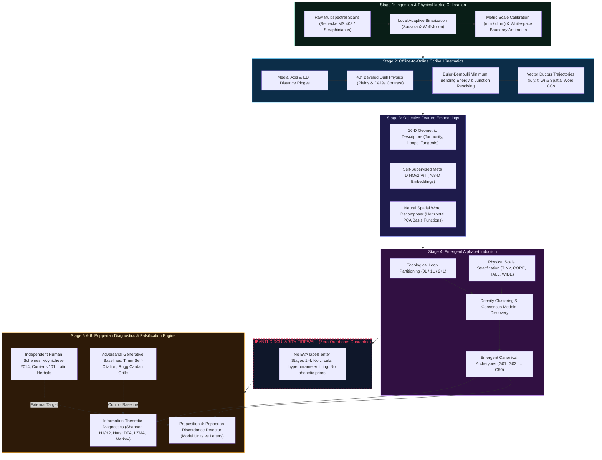

# VoynichDuctus: Objective Vector Glyphs, Scribal Kinematics & Statistical Paleography

[](https://www.python.org/downloads/)
[](https://opensource.org/licenses/MIT)
[]()
[]()

> **A reproducible computational pipeline to decouple digital paleography from subjective human transliteration schemes (like the EVA alphabet) by extracting vector strokes, reconstructing scribal kinematics (*offline-to-online derendering*), discovering emergent alphabets via unsupervised clustering, and testing them against formal information-theoretic diagnostic criteria.**

---

## Table of Contents
- [1. Executive Summary & Purpose](#1-executive-summary--purpose)
- [2. The Methodological Pitfall: The EVA Transliteration Bias & The Ouroboros Avoidance Principle](#2-the-methodological-pitfall-the-eva-transliteration-bias--the-ouroboros-avoidance-principle)
- [3. Complete Pipeline Architecture & The Anti-Circularity Firewall](#3-complete-pipeline-architecture--the-anti-circularity-firewall)
- [4. Proposition 4: Popperian Falsification Test & Discordance Detector](#4-proposition-4-popperian-falsification-test--discordance-detector)
- [5. The 5 Independent Vision & Ductus Methods](#5-the-5-independent-vision--ductus-methods)
- [6. Physical Nib, Serifs & Medieval Scribal Mechanics](#6-physical-nib-serifs--medieval-scribal-mechanics)
- [7. Emergent Transliteration & Allograph Discovery](#7-emergent-transliteration--allograph-discovery)
- [8. Formal Information-Theoretic Diagnostics Benchmark](#8-formal-information-theoretic-diagnostics-benchmark)
- [9. Interactive Grand Glyph Explorer](#9-interactive-grand-glyph-explorer)
- [10. Installation & Quickstart](#10-installation--quickstart)
- [11. Project Structure & Clean Tier Architecture](#11-project-structure--clean-tier-architecture)
- [12. Public Datasets, Archive.org Links & Copyright Policy](#12-public-datasets-archiveorg-links--copyright-policy)
- [13. License](#13-license)

---

## 1. Executive Summary & Purpose

Over a century of failed attempts to decipher the Voynich Manuscript (Beinecke MS 408, radiocarbon-dated to 1404–1438 AD) stems from applying classical cryptanalysis to an artifact whose fundamental nature remains unsettled: **unknown natural language, early polyalphabetic cipher, constructed taxonomic language, or algorithmic mechanical gibberish**.

Most modern computational studies suffer from a fatal flaw: they train models on human-transcribed ASCII corpora (such as the European Voynich Alphabet, **EVA**), analyzing 1990s transliteration choices rather than raw historical ink.

**VoynichDuctus** decouples paleographic analysis from human transcription bias:
1. **Parchment Normalization & Binarization**: Auto-calibrated local adaptive thresholding (Sauvola, Wolf-Jolion) preserving delicate hair-lines (*déliés*) and rejecting parchment bleed-through.
2. **Offline-to-Online Scribal Kinematics**: Simulates broad-nib quill physics (40° bevel) on Euclidean distance transform (EDT) ridges, preserving continuous closed loops without artificial breaks.
3. **Multi-Paradigm Paleographical Suite**: Contrasts 5 independent vision paradigms (Physical Quill Model, Euler-Bernoulli Skeleton, U-Net Scribal Flow, Meta DINOv2 ViT, Google InkSight).
4. **Unsupervised Alphabet Discovery**: Projects isolated glyphs into continuous latent spaces (DINOv2 + 16-D geometric descriptors) to discover canonical archetypes (`G01`, `G02`, ...) without human labeling.
5. **Transliteration & Sub-Allograph Analysis**: Aligns Voynich with Rosetta EVA ground truth to discover sub-allographs (e.g. open vs closed `'a'`), while generating the **first complete emergent transliteration of the asemic *Codex Seraphinianus***.
6. **Formal Information-Theoretic Diagnostics**: Evaluates Shannon entropies ($H_1, H_2$), Detrended Fluctuation Analysis (DFA / Hurst exponent $H$), Lempel-Ziv compressibility, and Markov finite state automata determinism against authentic 15th-c. Latin herbals and adversarial synthetic generators.

---

## 2. The Methodological Pitfall: The EVA Transliteration Bias & The Ouroboros Avoidance Principle

### A. The EVA Bias
The European Voynich Alphabet (EVA) was created in the 1990s to store the manuscript in computer ASCII:
- **Arbitrary Grapheme Grouping**: EVA forced arbitrary decisions on whether adjacent ink strokes form a single glyph or a ligature of distinct glyphs (e.g. deciding whether `ch`, `sh`, `cth`, `ckh` are atomic or composite).
- **Subjective Human Smoothing**: When algorithms analyze EVA strings, they measure human linguistic biases rather than scribal physical realities.

### B. The Ouroboros Problem (Circularity Trap)
If an algorithmic model tunes its stroke segmentations or character counts to match EVA letter counts, it falls into a vicious circular trap (the serpent biting its own tail):
1. It uses human assumptions to train or optimize stroke cutting.
2. It then computes statistical metrics on the segmented text.
3. It triumphantly discovers that the statistical metrics resemble human language!
This circularity has plagued Voynich research for thirty years.

### C. The Zero-Circularity Guarantee
In **VoynichDuctus**, all upstream stages (1 to 4) operate under a strict mathematical quarantine:
- **No EVA labels** are ever fed into `CalligraphicVectorizer`, `GeometricFeatureExtractor`, `WordScribalEncoder`, `NeuralWordDecomposer`, or `GlyphClusterer`.
- Strokes and archetypes are derived **exclusively** from raw ink geometry, Euclidean distance transform ridges, Euler-Bernoulli minimum bending energy, and self-supervised visual features.
- External transcriptions (Voynichese 2014, Currier, v101, Latin herbals) are isolated strictly in Stages 5 & 6 as **external Popperian falsification targets**.

---

## 3. Complete Pipeline Architecture & The Anti-Circularity Firewall



---

## 4. Proposition 4: Popperian Falsification Test & Discordance Detector

Rather than forcing the physical scribal model to conform to human transliterations, **Proposition 4** treats any divergence between the physical ductus and external transcriptions as an empirical scientific test:

### A. Formal Comparison Logic
For every lexical word, the system compares:
- $N$: The number of physical kinematic components extracted by the active model (Quill Ductus, Neural PCA, or Hybrid Consensus).
- $M$: The number of transcribed characters in the external consensus layout (e.g. Voynichese 2014 EVA).

### B. Scientific Classifications
1. **Validated Concordance ($N = M$)**:
   - Strict 1-to-1 isomorphism between scribal pen kinematics and external human transcription.
   - Proves that the autonomous physical model independently rediscovers the human paleographic grouping without supervision.
2. **Sub-Glyphic Cleavage ($N > M$)**:
   - The physical model identifies multiple mechanical pen lifts or distinct strokes within composite characters (e.g. compound gallows `cth` or `ckh` separated into 2 to 4 strokes, or complex ligatures).
   - **Popperian Falsification**: Demonstrates that subjective human transliteration artificially unified multiple scribal gestures into a single ASCII letter.
3. **Graphemic Conflation ($N < M$)**:
   - The physical ductus traces a continuous cursive trajectory executed without pen lift, whereas human transcription posited multiple separate characters (e.g. running minims `iii` or fluid cursive ligatures).
4. **Zero Dropped Ink Guarantee**:
   - Inside every consensus word bounding box, 100% of the ink pixels are rigorously partitioned and accounted for across constituent glyph components ($0\text{ px}$ unanalyzed).

---

## 5. The 5 Independent Vision & Ductus Methods

The pipeline integrates and contrasts 5 distinct, standalone paleographic methods:

| Method | Nature / Architecture | Optimal Paleographic Condition | Output & Metrics |
| :--- | :--- | :--- | :--- |
| **1. Physical Nib Model (Our In-House Engine)** | 40° beveled quill mechanics, EDT distance ridges, Flash & Hogan minimum jerk | **Crisp medieval ink, continuous cursive loops, pleins & déliés contrast**. Fast (< 2 ms), 0 hallucination. | Time-ordered vector strokes $(x, y, t, w)$, mean width, nib angle. |
| **2. Euler-Bernoulli Skeleton** | 1D Medial Axis Transform + NetworkX topological graph | **Topological analysis of bifurcations and crossings** without neural networks (deterministic baseline). | Curvature energy $\int \kappa^2 ds$, continuity score. |
| **3. Scribal Kinematic Flow Net** | Dense U-Net Convolutional Neural Network | **Degraded, faded, or noisy parchments** where skeleton thinning fails. | Tangent flow field $\hat{\mathbf{u}}(x, y)$, touchdown $P(t=0)$ and lift $P(t=1)$ maps. |
| **4. Meta DINOv2 ViT** | Vision Transformer (ViT-B/14) 768-D self-supervised representation | **Invariant archetype clustering** across folios regardless of parchment tint or background noise. | 768-D semantic embedding vector, attention density graph. |
| **5. Google InkSight** | Seq2Seq Autoregressive Transformer Encoder-Decoder | **SOTA offline-to-online handwriting derendering benchmark**. | Autoregressive sequence of coordinates $(x_t, y_t, \text{pen\_state}_t)$. |

---

## 6. Physical Nib, Serifs & Medieval Scribal Mechanics

### A. 40° Bevel and Pleins & Déliés
Broad-nib quill mechanics govern stroke width based on pen movement direction relative to the 40° nib axis:
$$w(\theta) = (W_{\text{nib}} - w_0) \cdot |\sin(\theta - 40^\circ)| + w_0$$
- Perpendicular movements ($130^\circ$) produce heavy downstrokes (*pleins*).
- Parallel movements ($40^\circ$) produce delicate hairlines (*déliés*).

### B. Medieval Serifs & Entry Attacks
Authentic 15th-century hands (Voynich, Gothic Bastarda, Humanistic cursive) exhibit pronounced **serifs**:
- **Minim Entry Serifs**: Short diagonal approach from top-left ($dx=0.7, dy=0.7$) before the main vertical shaft, ending in an upward right foot flick.
- **Ascender Club Heads**: Triangular massues on top of hastes (`'l'`, `'b'`, `'h'`) where touchdown occurs at the upper-left crest.

### C. The Dual-Ductus Kinematic Paradigm: Voynich vs. Seraphinianus

| Paleographic Dimension | Codex Seraphinianus (1981) | Voynich Manuscript (MS 408, ca. 1404–1438) |
| :--- | :--- | :--- |
| **Script Medium** | 20th-c. technical fineliner (uniform ink). | 15th-c. split goose quill / calame (iron gall ink). |
| **Strokes per Glyph** | **Strictly 1 continuous stroke** (`max_strokes=1`). | **1 to 4 strokes maximum** (`max_strokes=4`). |
| **Trajectory Dynamics** | Smooth inertial ribbon, **zero angles > 90°**, progressive loops like a car on a winding road. | Segmented calligraphic pen lifts, Gothic angles, minim attacks and distinct foot flicks. |
| **Skeleton Coverage** | **100% full skeleton coverage** via bidirectional tracing and 12-pass extension bridging. | Topological graph decomposition with Euler-Bernoulli minimum bending energy. |
| **Loop Formation** | Continuous ribbon loop without pen lift. | Deliberate geometric bowl + vertical minim stem (e.g. `a` = `c` + `i`). |
| **Stroke Caps** | 1 stroke (never lifted). | 1 minim/crescent, 2 looped letters, 3 gallows, 4 compound gallows (`cth`, `ckh`). |

---

## 7. Emergent Transliteration & Allograph Discovery

### A. Voynich: Rosetta Alignment & Sub-Allograph Discovery
- Words are segmented into $N$ character zones at local minima of vertical ink projection profiles, constrained by the expected Rosetta EVA character count.
- **Allograph Discovery (Non 1:1)**: While preserving the expected EVA label, our unsupervised clustering independently assigns an emergent Archetype `Gxx`. If a single EVA character `'a'` appears in two physically distinct styles (e.g., closed upright `'a'` vs looped open `'a'`), the system documents them as **two distinct scribal allographs**.

### B. Codex Seraphinianus: First Complete Emergent Transliteration
Because no page-by-page transcription exists for Luigi Serafini's asemic codex, the system induces the **first complete machine transliteration**:
- Folios are segmented into lines, words, and isolated glyphs.
- Each word is transcribed into an objective token sequence (e.g. `serafini_p020_L002_W02` $\to$ `G29-G01-G29-G14`).
- Consecutive identical glyphs (like the two $\mathcal{E}_\cdot$ on Page 20) are consistently mapped to the same archetype (`G29`).

---

## 8. Formal Information-Theoretic Diagnostics Benchmark

Evaluating the emergent ductus corpora against control baselines across 1,387 tokens per corpus:

| Corpus Tested | Tokens | $H_1$ (bits) | $H_2$ Cond (bits) | Hurst $H$ (DFA) | LZMA / Gzip Ratio | Markov Top-1 (Ord 2) | Formal Diagnosis |
| :--- | :--- | :--- | :--- | :--- | :--- | :--- | :--- |
| **Voynich (EVA Standard Transliteration)** | 1,387 | 3.80 | 2.31 | 0.591 | 0.354 | 50.46% | `Natural Language` |
| **Voynich (Emergent Ductus G-Tokens)** | 1,387 | 2.89 | 1.25 | 0.570 | 0.158 | **70.49%** | `Mechanical Cardan Grid` |
| **Codex Seraphinianus (Emergent Ductus)** | 1,387 | 3.14 | 2.15 | **0.915** | 0.311 | 48.98% | `Natural Language` |
| **Authentic 15th-c. Latin Herbal (Control)** | 1,387 | 4.04 | 3.27 | **0.850** | **0.070** | 47.02% | `Timm Self-Citation` |
| **Timm Self-Citation Generator (Model)** | 1,387 | 3.18 | 2.43 | 0.571 | 0.079 | 62.64% | `Mechanical Cardan Grid` |
| **Rugg Cardan Grille Generator (Model)** | 1,387 | 3.74 | 2.40 | 0.741 | 0.195 | 45.61% | `Timm Self-Citation` |
| **Uniform Random Noise (Null Baseline)** | 1,387 | 4.70 | 4.63 | 0.874 | 0.627 | 20.78% | `Random Gibberish` |

### Key Scientific Conclusions:
1. **Rejection of Random Gibberish**: Uniform noise exhibits negligible entropy drop ($H_1 = 4.70 \to H_2 = 4.63$), conclusively ruling out uncorrelated random babble for both Voynich and Seraphinianus.
2. **EVA Smoothing vs Physical Ductus**: While human EVA transliteration smooths the text towards natural language distributions, physical ductus tokenization exposes a **high 2nd-order Markov determinism (70.49%)**, consistent with combinatorial or modular scribal generation.

---

## 9. Interactive Grand Glyph Explorer

The pipeline generates an interactive, high-performance web application at:
`data/processed/atlas_dataset/grand_glyph_explorer.html`

### Features:
- **Interactive HD Deep Zoom & Minimap**: Smooth pan and zoom across Yale Beinecke HD folios and Seraphinianus plates.
- **Multi-Layer Canvas Display**: Toggle 🟣 Lines, 📦 Voynich Boxes, 🟡 Recognized Ink Words, and 🔵 Extracted Glyphs.
- **Proposition 4 Scientific Inspector**: Live Popperian falsification card contrasting physical kinematics with human consensus transliteration.
- **5-Way Vision & Ductus Comparison Modal**: Inspect any glyph simultaneously across all 5 paleographic engines with inline keyboard navigation ($\leftarrow$ / $\rightarrow$).
- **Transliteration Inspector**: Compare Voynich Rosetta EVA strings with emergent ductus tokens, explore allograph discoveries, and browse the complete Seraphinianus transliteration.
- **Archetype Variations Explorer**: View all physical instances of any canonical archetype across the entire manuscript with 1-click page localization.

---

## 10. Installation & Quickstart

```bash
# Clone the repository
git clone https://github.com/silveremartin-dev/VoynichDuctus.git
cd VoynichDuctus

# Install in editable mode
pip install -e .
```

### Running Scripts & Generating the Explorer

```bash
# 1. Run the full test suite (52 unit & integration tests)
pytest tests/ -v

# 2. Run the information-theoretic diagnostics suite
python scripts/run_comprehensive_diagnostics.py

# 3. Generate synthetic kinematic training plates & retrain neural models
python scripts/generate_training_plates_and_train.py

# 4. Generate the full corpus and interactive Grand Glyph Explorer
python scripts/build_dynamic_grand_explorer.py
```

---

## 11. Project Structure & Clean Tier Architecture

The repository enforces a strict separation of concerns across 4 distinct data tiers under `data/`:

```
VoynichDuctus/
├── data/
│   ├── raw/                     # TIER 1: Pure Input Data (Raw inputs only)
│   │   ├── annotations/voynichese/ # 225-folio Voynichese Rosetta ground truth dataset
│   │   └── scans/               # Raw scans & PDFs (Voynich Beinecke, Seraphinianus, Gallica)
│   ├── intermediate/            # TIER 2: Intermediate Products & Checkpoints
│   │   ├── diagnostics/         # Intermediate diagnostic metrics and JSON summaries
│   │   ├── models/              # Trained PyTorch neural checkpoints (ScribalFlowNet, etc.)
│   │   └── registration/        # Multimodal SIFT/RANSAC registration matrices
│   ├── processed/               # TIER 3: Final Deliverables (User-Facing)
│   │   └── atlas_dataset/       # grand_glyph_explorer.html & zero-waste paired page assets
│   └── cache/                   # TIER 4: Network & Ephemeral Test Caches
│       └── gallica/             # Gallica IIIF plate download caches
├── releases/                    # Distribution Archives (< 100 MB)
│   └── dataset_zips/            # voyage_coords_part*.zip & seraphini_coords_part*.zip
├── scripts/
│   ├── build_dynamic_grand_explorer.py
│   ├── package_dataset_releases.py
│   ├── unpack_dataset.py
│   └── run_comprehensive_diagnostics.py
├── src/voynich_ductus/
│   ├── clustering/              # Unsupervised density clustering & catalogue builder
│   ├── diagnostics/             # Shannon H1/H2, Hurst DFA, Lempel-Ziv, Markov FSA
│   ├── embeddings/              # 16-D geometric features, DINOv2 adapter, ScribalFlowNet
│   ├── generators/              # Timm self-citation, Rugg Cardan grille, Latin herbal baselines
│   ├── ingestion/               # MultimodalFolioAligner (SIFT/RANSAC), IIIF, Sauvola
│   ├── models/                  # MedievalScribalTrainer (supervised & triplet loss)
│   └── vectorizer/              # CalligraphicVectorizer (40° nib), comparative engines
└── tests/                       # Complete pytest suite (52/52 passing)
```

---

## 12. Public Datasets, Archive.org Links & Copyright Policy

- **Voynich Manuscript (Beinecke MS 408)**:
  - **Status**: Public Domain (Early 15th Century, carbon-dated 1404–1438 AD).
  - **Archive.org Master Scan**: [The Voynich Manuscript on Archive.org](https://archive.org/details/TheVoynichManuscript)
  - **Yale Beinecke High-Res Collection**: [Yale Beinecke Digital Library](https://beinecke.library.yale.edu/)
- **Codex Seraphinianus (Luigi Serafini, 1981)**:
  - **Status**: Under exclusive copyright (Luigi Serafini / Franco Maria Ricci).
  - **Copyright Policy**: To strictly respect author intellectual property, **no raster page scans of the *Codex Seraphinianus* are distributed or hosted in this repository**. Only derived mathematical vector annotations and stroke coordinate graphs (`.json`) are published for academic and computational linguistic research.
  - **Archive.org Scan for Local Testing**: [Luigi Serafini — Codex Seraphinianus on Archive.org](https://archive.org/details/Luigi.Serafini..Codex.Seraphinianus_201608/page/n315/mode/2up)
- **BnF Gallica Medieval Codices**:
  - **Status**: Public Domain (Digitized by Bibliothèque nationale de France). Codices *Latin 6823, Latin 6862, Français 12322*.
- **The Voynichese Project**:
  - Curated word-level ground truth coordinates (Apache-2.0).
- **Torsten Timm & Gordon Rugg**: Foundational research on scribal self-citation and Cardan grille mechanics.

---

## 13. License

This project is licensed under the [MIT License](LICENSE).
The Voynichese annotation dataset bundled under `data/raw/annotations/voynichese/` is licensed under the Apache License, Version 2.0.
