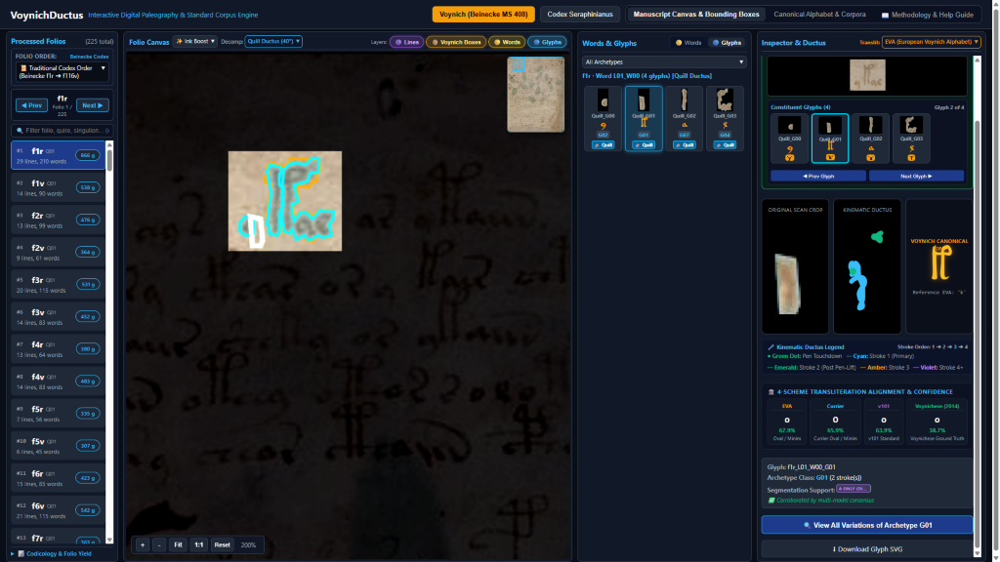
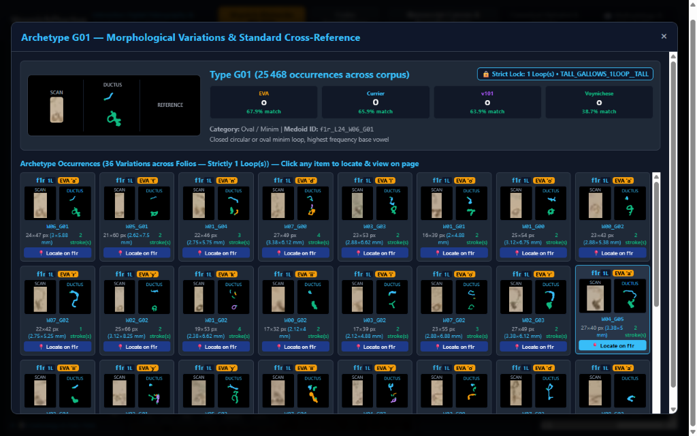
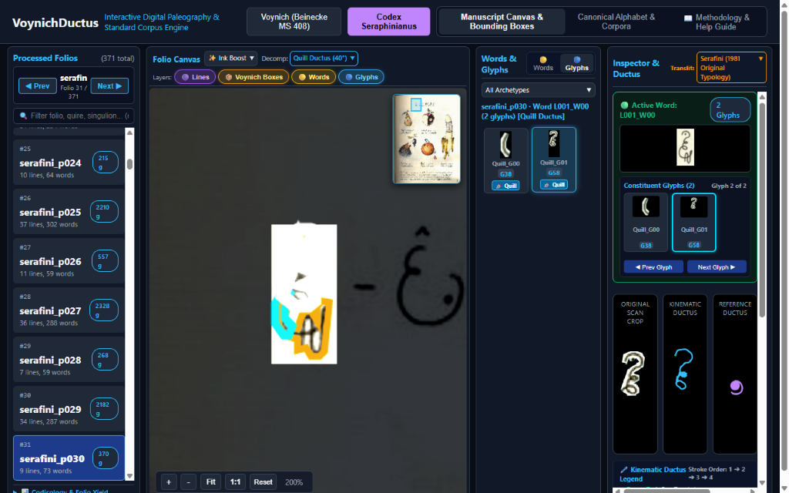
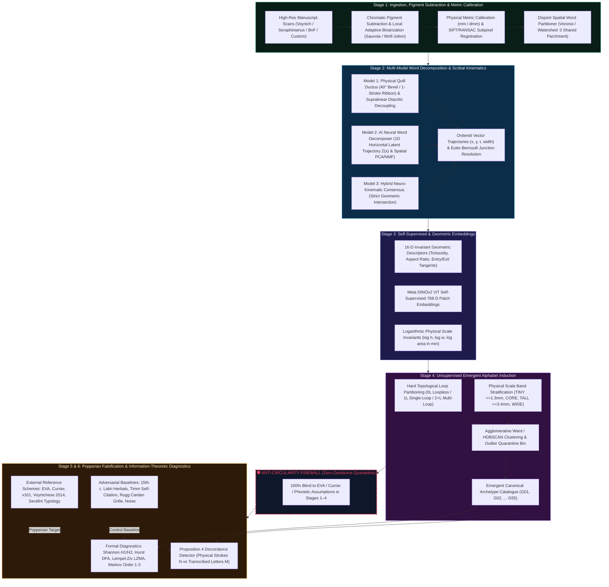

# VoynichDuctus: An Experimental Digital Paleography Laboratory for Autonomous Word, Letter & Glyph Recognition, Kinematic Ductus Reconstruction & Unsupervised Archetype Induction

[](https://www.python.org/downloads/)
[](https://opensource.org/licenses/MIT)
[]()
[]()
[]()

> **More than a Voynich tool: an open-source experimental paleography laboratory.**  
> Although named **VoynichDuctus** after its historical testbed (*Beinecke MS 408*), this framework is a **universal, script-agnostic computational laboratory** built to perform **fully automatic recognition of lines, words, letters, and glyphs**, **reconstruct dynamic scribal ductus** (*offline-to-online stroke derendering*), and **induce canonical alphabet archetypes via unsupervised machine learning**—with zero reliance on human transcription schemes.  
> Currently deployed across the **Voynich Manuscript** (225 folios), Luigi Serafini's asemic **Codex Seraphinianus** (371 pages), and **14th/15th-century BnF Gallica medieval codices**, its modular metric-calibrated architecture is directly extensible to any historical manuscript, undeciphered script, or calligraphic corpus.


---

## Table of Contents

- [1. What VoynichDuctus Does: An Experimental Laboratory for Autonomous Script Recognition & Ductus Induction](#1-what-voynichductus-does-an-experimental-laboratory-for-autonomous-script-recognition--ductus-induction)
- [2. Visual Tour & Interactive Grand Glyph Explorer (`grand_glyph_explorer.html`)](#2-visual-tour--interactive-grand-glyph-explorer-grand_glyph_explorerhtml)
  - [2.1 Synchronized 4-Panel Workbench & Word-Level Ductus Inspector](#21-synchronized-4-panel-workbench--word-level-ductus-inspector)
  - [2.2 Glyph-Level Dual-Ductus Comparison (Quill 40° vs. Euler-Bernoulli Skeleton)](#22-glyph-level-dual-ductus-comparison-quill-40-vs-euler-bernoulli-skeleton)
  - [2.3 Three Independent Word Decomposition Modes (`word_decomposition`: A, B, C)](#23-three-independent-word-decomposition-modes-word_decomposition-a-b-c)
  - [2.4 Unsupervised Canonical Alphabet & Graphical Symbol Catalogue](#24-unsupervised-canonical-alphabet--graphical-symbol-catalogue)
  - [2.5 Cross-Folio Archetype Variations & 1-Click Page Localization](#25-cross-folio-archetype-variations--1-click-page-localization)
  - [2.6 Codex Seraphinianus: Continuous Cursive Ribbon & Emergent Vector Symbols](#26-codex-seraphinianus-continuous-cursive-ribbon--emergent-vector-symbols)
  - [2.7 Built-In Scientific Methodology & BnF Gallica Calibration Reference](#27-built-in-scientific-methodology--bnf-gallica-calibration-reference)
- [3. The Epistemic Trap: Human Transliteration Bias & The Anti-Circularity Firewall](#3-the-epistemic-trap-human-transliteration-bias--the-anti-circularity-firewall)
- [4. End-to-End 6-Stage Pipeline Architecture](#4-end-to-end-6-stage-pipeline-architecture)
- [5. Autonomous Multi-Scale Recognition: From Raw Parchment to Disjoint Words & Word Decomposition](#5-autonomous-multi-scale-recognition-from-raw-parchment-to-disjoint-words--word-decomposition)
- [6. Scribal Physics & Dual-Ductus Kinematics: Medieval Quill vs. Modern Cursive Ribbon](#6-scribal-physics--dual-ductus-kinematics-medieval-quill-vs-modern-cursive-ribbon)
- [7. Dual-Engine Ductus & DINOv2 (16-D PCA) Archetype Induction](#7-dual-engine-ductus--dinov2-16-d-pca-archetype-induction)
- [8. Unsupervised Archetype Induction & Popperian Falsification (Proposition 4)](#8-unsupervised-archetype-induction--popperian-falsification-proposition-4)
- [9. Corpus Scale & Information-Theoretic Diagnostics Benchmark](#9-corpus-scale--information-theoretic-diagnostics-benchmark)
- [10. Extending the Laboratory to New Manuscripts & Writing Systems](#10-extending-the-laboratory-to-new-manuscripts--writing-systems)
- [11. Installation, CLI & Quickstart](#11-installation-cli--quickstart)
- [12. Repository Architecture & 4-Tier Data Lifecycle](#12-repository-architecture--4-tier-data-lifecycle)
- [13. Public Datasets, Archive.org Sources & Copyright Policy](#13-public-datasets-archiveorg-sources--copyright-policy)
- [14. License](#14-license)

---

## 1. What VoynichDuctus Does: An Experimental Laboratory for Autonomous Script Recognition & Ductus Induction

**What does this project actually do?**  
Give `VoynichDuctus` raw scans of any manuscript—whether historical, undeciphered, or completely invented—and it executes a **100% automated, end-to-end paleographical analysis without any human intervention or prior alphabet**:

1. **Automatic Spatial Recognition (Lines $\to$ Words $\to$ Word Decomposition into Letters & Glyphs)**:
   - Filters out colored illustrations and parchment stains, detects text lines, and partitions the page into **strictly disjoint lexical words** (via Voronoi/watershed boundary arbitration with zero overlapping boxes).
   - Decomposes each word into its constituent **letters, glyphs, and decoupled supralinear diacritics** using three parallel **Word Decomposition (`word_decomposition`)** modes: **A · Topological & Valley (40°)**, **B · Spatial PCA Decomposition** (`||dZ/dx||` horizontal latent transitions), and **C · Hybrid Consensus** (their geometric intersection with loop protection). Every glyph across all 3 decompositions receives its own complete Dual-Engine Ductus.
2. **Automatic Dual-Engine Kinematic Ductus Reconstruction (*Offline-to-Online Derendering*)**:
   - Infers how the writer's hand actually moved across the page and displays **two complementary ductus reconstructions side-by-side** for every glyph:
     1. **Quill Calligraphic Ductus (40° Nib)**: Physical ridge tracker with lateral spur pruning, full nib-footprint extinction (`wake_mask` preventing internal zigzag or U-turns inside thick stems), Ramer-Douglas-Peucker spline simplification, and chronological stroke order (`●` Green touchdown, `1` $\to$ `2` $\to$ `3` $\to$ `4`).
     2. **Euler-Bernoulli Topological Skeleton**: Pure 1D Medial Axis Transform + `NetworkX` graph junction resolver minimizing bending energy $\int \kappa^2(s)\,ds$.
3. **Automatic Unsupervised Alphabet & Graphical Archetype Induction**:
   - Without knowing what alphabet is written on the page, the engine projects every extracted glyph into a joint visual, kinematic, and topological space (**16-D PCA projection of Meta DINOv2 ViT 768-D embeddings + high-weight kinematic ductus descriptors + physical millimeter scale bands**) and clusters them into an **emergent canonical alphabet of archetypes** (`G01`–`G49` for Voynich; `G01`–`G57` graphical vector symbols for Codex Seraphinianus).

### Why Two Flagship Codices? (Voynich MS vs. Codex Seraphinianus) — And Why It Extends to Any Project

Although the project is named **VoynichDuctus** after its initial benchmark, it is designed as a **comparative experimental laboratory** tested simultaneously on two radically different scripts—and extensible to any future manuscript project:

| Experimental Dimension | 1. Voynich Manuscript (*Beinecke MS 408*, ca. 1404–1438) | 2. *Codex Seraphinianus* (Luigi Serafini, 1981) | 3. Extensibility to Other Manuscripts & Scripts |
| :--- | :--- | :--- | :--- |
| **Nature of the Script** | Undeciphered 15th-century medieval codex (225 folios). | Famous 20th-century **asemic encyclopedia** (371 pages) written in an imaginary, untranscribed cursive script with **no existing alphabet or human transliteration**. | Any historical manuscript, undeciphered writing system (Rohonc Codex, Rongorongo, Linear A, Indus script), medieval palimpsest, or calligraphic corpus. |
| **Why It Is in the Lab** | **Testbed for Falsifying Human Transliterations (EVA)**: Tests whether physical quill strokes match or refute 1990s human ASCII transcriptions (*Proposition 4*). | **Ultimate Blind Test for Pure Unsupervised Discovery**: Because no transcription exists for *Seraphinianus*, the pipeline recognizes all **68,430 words** and **456,943 glyphs**, reconstructs their continuous cursive ribbon ductus, induces **57 canonical graphical symbol archetypes (`G01`–`G57`)**, and produces the **first complete autonomous machine transliteration** of the codex from scratch. | **Universal Metric & Kinematic Plug-and-Play**: Calibrates automatically to any page size in millimeters (`MetricScaleCalibration`) and any writing tool (broad quill, reed calame, brush, or monoline stylus). |
| **Physical Ductus Mode** | **Multi-Stroke Medieval Quill (`1 to 4 strokes/glyph`)**: 40° beveled goose quill producing *pleins et déliés* and deliberate pen lifts (calibrated on 3 BnF Gallica medieval codices). | **Single-Stroke Cursive Ribbon (`1 continuous stroke/glyph`)**: Modern monoline fineliner (`single_stroke_mode=True`) moving with smooth automotive inertia and zero internal pen lifts. | Configurable physical profile (`single_stroke_mode`, `max_strokes`, `nib_angle_deg`) tailored to the target scriptorium or medium. |
| **Processed Corpus Scale** | **225 folios** $\to$ **37,212 disjoint words** $\to$ **162,333 canonical glyphs** (**49 archetypes `G01`–`G49`**). | **371 pages** $\to$ **68,430 disjoint words** $\to$ **456,943 glyphs** (**57 emergent graphical symbol archetypes `G01`–`G57`**). | Ready for batch processing locally or at cloud scale (Docker / Google Cloud Run). |

---

## 2. Visual Tour & Interactive Grand Glyph Explorer (`grand_glyph_explorer.html`)

The pipeline compiles its entire multi-codex output into a standalone, zero-dependency interactive web workbench located at `data/processed/atlas_dataset/grand_glyph_explorer.html` (launchable in one click via `launch_explorer.bat`).

### 2.1 Synchronized 4-Panel Workbench & Word-Level Ductus Inspector


*Figure 1 — The 4-panel workspace on Voynich folio `f1r` with word `L01_W00` (`ykal`) selected:*
- **Panel 1 (Left — Folio Navigator)**: Browse all 225 Voynich folios or 371 Seraphinianus pages. Switch dynamically between **Traditional Beinecke Codex Order** (`f1r` $\to$ `f116v`) and **Singulion Quire Order** (*Layfield & Davis, Digital Medievalist 2026*).
- **Panel 2 (Center-Left — Deep-Zoom Parchment Canvas)**: Interactive high-resolution viewport (up to 800% magnification) with live minimap, image filters (*Ink Boost*, *High-Pass*, *Pure Ink*, *Natural*), real-time segmentation model selector (*Quill Ductus 40°*, *AI Neural PCA*, *Hybrid Consensus*), and toggleable vector layers (`🟣 Lines`, `📦 Voynich Boxes`, `🟡 Words`, `🔵 Glyphs`).
- **Panel 3 (Center-Right — Words & Glyphs Grid)**: Instant switching between extracted lexical word crops (`🟡 Words`) and constituent character crops (`🔵 Glyphs`), filterable by induced canonical archetype.
- **Panel 4 (Right — Inspector & Kinematic Ductus)**: Displays the selected word's canonical calligraphy, 4-scheme transliteration correspondence (`EVA`, `Currier`, `v101`, `Voynichese 2014`), raw parchment ink crop, **Proposition 4 Scribal Ductus Analysis** (`1:1 PARITY`: 4 physical strokes $\equiv$ 4 reference letters, 100% ink assigned), and multi-model decomposition agreement (`HIGH CONSENSUS`: Quill 4, Neural 4, Hybrid 4).

---

### 2.2 Glyph-Level Dual-Ductus Comparison (Quill 40° vs. Euler-Bernoulli Skeleton)



*Figure 2 — Drilling down into an individual glyph (`f1r_L01_W00_G01`, Archetype `G01`, 2 strokes) inside word `L01_W00`:*
- **Constituent Glyph Strip**: Navigate sequentially (`◀ Prev Glyph` / `Next Glyph ▶`) across the characters composing the active word.
- **4-Box Side-by-Side Visual Verification**:
  1. **Original Scan Crop**: High-contrast parchment crop of the isolated character.
  2. **Quill Ductus (40° Nib)**: Our physical calligraphic reconstruction with chronological color encoding (`● Green Dot` = Pen Touchdown, `— Cyan` = Stroke 1, `— Emerald` = Stroke 2 post pen-lift, `— Amber` = Stroke 3, `— Violet` = Stroke 4), full nib-footprint extinction (no internal Brownian bounce), and Ramer-Douglas-Peucker spline smoothing.
  3. **Euler-Bernoulli Skeleton**: Side-by-side comparative topological skeleton graph extracted via 1D Medial Axis Transform + `NetworkX` minimum bending energy $\int \kappa^2(s)\,ds$.
  4. **Canonical Reference Font (Voynich) / Emergent Archetype Symbol (Seraphinianus)**: Visual comparison with reference paleographic typography (`VoynichEVA`) or the induced graphical SVG symbol (`G01`–`G57`).
- **Transliteration Alignment & Graphical Topology**: Simultaneous posterior cross-checking against `EVA`, `Currier`, `v101`, and `Voynichese (2014)` for Voynich, or **Emergent Serafinian Graphical Symbol & Topology** (SVG Archetype Symbol + Euler-Bernoulli Graph + Morphological Family SVG) for Codex Seraphinianus.

---

### 2.3 Three Independent Word Decomposition Modes (`word_decomposition`: A, B, C)

Using the **`Word Decomposition`** selector in the Canvas toolbar (or keyboard keys `1`, `2`, `3`), researchers can switch dynamically between three independent hypotheses for splitting words into constituent glyphs—with full **Quill 40° + Euler-Bernoulli Dual Ductus** computed on every glyph of all three decompositions:
1. **`A · Topological & Valley (40°)` (`GlyphSegmenter`)**: Connected components + supralinear diacritic decoupling ($\le 0.55\text{ mm}$) + vertical projection & Euclidean Distance Transform (EDT) ink valleys that strictly respect closed loops.
2. **`B · Spatial PCA Decomposition` (`NeuralWordDecomposition`)**: Encodes the intact word crop into a 1D horizontal latent trajectory $Z(x) \in \mathbb{R}^{32}$ via `WordScribalEncoder` and places cuts at local peaks of the latent transition velocity $\|dZ/dx\|$.
3. **`C · Hybrid Consensus` (`HybridConsensusWordDecomposition`)**: Retains cuts where Decompositions A and B geometrically intersect ($\epsilon \le 3\text{ px}$) while enforcing Euler loop integrity.

---

### 2.4 Unsupervised Canonical Alphabet & Graphical Symbol Catalogue


*Figure 4 — The **Canonical Alphabet & Corpora** tab (`setTab('catalogue')`):*
- Displays the emergent alphabet induced purely from ink geometry, kinematic ductus features, 16-D PCA DINOv2 embeddings, topological loop invariants (`0L`, `1L`, `2+L`), and physical millimeter scale bands (`TINY`, `CORE`, `TALL`, `WIDE`).
- Each archetype card (`49 archetypes G01–G49` for Voynich; `57 archetypes G01–G57` for Seraphinianus) displays a **4-column visual comparison** (`SCAN` | `QUILL DUCTUS` | `EULER-BERNOULLI` | `CANONICAL FONT / SYMBOL`), corpus occurrence count, loop lock badge, and physical dimensions in pixels and millimeters (`mm` / `dmm`).

---

### 2.5 Cross-Folio Archetype Variations & 1-Click Page Localization



*Figure 5 — Clicking any archetype card opens the **Archetype Morphological Variations Explorer**:*
- Inspect all physical instances of an induced archetype across the manuscript, complete with its 4-box header banner (`SCAN` | `QUILL 40°` | `EULER-BERN.` | `SYMBOL / REFERENCE`).
- Each variation card shows the local `SCAN` crop alongside its reconstructed `DUCTUS` trajectory, physical metric dimensions (`mm`), stroke count, and a **`📍 Locate on f1r`** button that jumps directly to the folio canvas and highlights the exact glyph in context.

---

### 2.6 Codex Seraphinianus: Continuous Cursive Ribbon & Emergent Vector Symbols




*Figure 6 — Switching the top header to **Codex Seraphinianus** on plate `serafini_p030`:*
- **Word-Level Autonomous Transliteration**: Words are automatically segmented and transcribed into emergent vector letterforms (`G01`–`G57`).
- **Graphical Vector Symbols Instead of Fake ASCII Codes**: Because no standardized ASCII alphabet exists for *Codex Seraphinianus*, the Explorer renders **actual graphical SVG symbols** for every archetype (`Archetype Symbol SVG`, `Euler-Bernoulli Graph SVG`, and `Morphological Family SVG`) alongside certified loop counts (`0L/1L/2+L`) and metric dimensions in `mm`.
- **Single-Stroke Continuous Ribbon Ductus**: Enforces Serafini's modern fineliner physics (`single_stroke_mode=True`, `max_strokes=1`), tracing the entire curvilinear character in a single uninterrupted stroke with smooth automotive inertia.

---

### 2.7 Built-In Scientific Methodology & BnF Gallica Calibration Reference


*Figure 7 — The **📖 Methodology & Help Guide** tab embeds five interactive documentation panes directly inside the application:*
1. **Interface & Commands Guide**: 4-panel architecture and keyboard shortcuts (`◀`/`▶` folios, `1`/`2`/`3` segmentation models, `L`/`B`/`W`/`G` canvas layers, `Escape` reset).
2. **Approach: Common vs. Codex-Specific**: Universal spatial pipeline vs. writing-instrument physical bifurcation.
3. **Sources & Gallica BnF Calibration**: Direct IIIF ARK links and calibrated parameters from *BnF Latin 6823*, *BnF Latin 17868*, and *BnF Latin 10533304x*.
4. **Segmentation Models & Anti-Circularity**: Formal definition of the 3 decomposition models and the Ouroboros prevention protocol.
5. **Results & Corpus Statistics**: Complete census tables and information-theoretic benchmarks.

---

## 3. The Epistemic Trap: Human Transliteration Bias & The Anti-Circularity Firewall

### A. Why Transliteration-Based Studies Fail (The EVA Bias)
The European Voynich Alphabet (EVA) was designed in 1998 to encode the manuscript into 7-bit ASCII:
- **Arbitrary Compound Grouping**: EVA makes subjective decisions on whether adjacent strokes constitute a single letter or a multi-letter sequence (e.g., treating bench ligatures `ch`, `sh` or compound gallows `cth`, `ckh` as digraphs/trigraphs, or splitting connected minim waves `aiin` into four letters).
- **Allograph Conflation**: Visually distinct scribal gestures are collapsed into a single ASCII symbol, while minor flourish variations are split into separate letters.

### B. The Ouroboros Circularity Trap
When a computational pipeline uses EVA character counts to tune its glyph segmentation or train its recognizer, and then runs statistical linguistics on the resulting tokens, it falls into the **Ouroboros trap** (the serpent eating its own tail): the model merely rediscovers the human linguistic assumptions baked into EVA in 1998.

### C. Our Anti-Circularity Firewall (Zero-Ouroboros Guarantee)
In **VoynichDuctus**, Stages 1 through 4 operate behind an air-tight mathematical quarantine:
- **Zero Transcription Labels in Upstream Stages**: No EVA, Currier, v101, or Latin labels ever enter `Binarizer`, `SpatialWordPartitioner`, `CalligraphicVectorizer`, `WordScribalEncoder`, `NeuralWordDecomposer`, or `GlyphClusterer`.
- **Purely Physical & Topological Priors**: Stroke extraction and clustering rely exclusively on ink reflectance, metric millimeter thresholds, Euclidean distance ridges, 40° quill bevel geometry, Euler-Bernoulli bending energy, and self-supervised visual representations (DINOv2).
- **Downstream Popperian Falsification Only**: Human schemes (EVA, Currier, v101, Voynichese 2014) are loaded strictly in Stages 5 & 6 as external reference targets to measure concordance and expose transcription biases.

---

## 4. End-to-End 6-Stage Pipeline Architecture



---

## 5. Autonomous Multi-Scale Recognition: From Raw Parchment to Disjoint Words & Letters

To serve as an automated laboratory across heterogeneous manuscripts, `VoynichDuctus` implements six foundational computer vision and codicological innovations:

1. **Physical Millimeter Calibration (`MetricScaleCalibration`)**:
   - Digital scans vary wildly in pixel density: Yale Voynich HD plates run at $\approx 14.08\text{ px/mm}$ ($225\text{ mm}$ height), standard Voynich scans at $\approx 8.00\text{ px/mm}$, and Codex Seraphinianus folio plates at $\approx 6.28\text{ px/mm}$ ($350\text{ mm}$ height).
   - Hardcoded pixel thresholds fail across manuscripts. Every filter in `VoynichDuctus` is defined in physical **millimeters (mm)** and **tenths of a millimeter (dmm)**:
     - Nib touchdown dot impact: $\text{diameter} \le 0.55\text{ mm}$ ($5.5\text{ dmm}$), $\text{area} \le 0.35\text{ mm}^2$.
     - Minimum legible glyph extent: $H \ge 0.85\text{ mm}$ ($8.5\text{ dmm}$), $W \ge 0.45\text{ mm}$ ($4.5\text{ dmm}$).
     - Physical scale bands: `TINY` ($H \le 1.30\text{ mm}$), `CORE` ($1.30 < H < 3.40\text{ mm}$), `TALL` ($H \ge 3.40\text{ mm}$), `WIDE` ($W \ge 3.40\text{ mm}$).
     - Inter-word whitespace threshold: $\ge 1.10\text{ mm}$ ($11.0\text{ dmm}$).

2. **Chromatic Pigment Subtraction & Adaptive Binarization**:
   - Separates low-chroma scribal ink ($\Delta\text{RGB} \le 0.16, S \le 0.20$) from high-chroma botanical green, azurite blue, and rubric red illustrations prior to dual-window Sauvola ($k=0.2, R=128$) and Wolf-Jolion thresholding.

3. **Multimodal SIFT/RANSAC Subpixel Image Registration (`MultimodalFolioAligner`)**:
   - Aligns reference coordinate sets onto native Yale Beinecke HD master plates ($2400 \times 3300\text{ px}$) across all 225 folios via subpixel affine transformation $M \in \mathbb{R}^{2 \times 3}$, correcting translation shifts ($T_x \in [234, 500]\text{ px}$) and camera tilts ($\theta \in [-1.5^\circ, +1.5^\circ]$) for a **+750% area resolution gain** and **100% word ink hit rate**.

4. **Strict Disjoint Spatial Word Partitioning (`SpatialWordPartitioner`)**:
   - Enforces mutual spatial exclusivity across all words on a page ($M_{w_i} \cap M_{w_j} = \emptyset$). Contested bounding regions are arbitrated via geodesic Voronoi/watershed tessellation against lexical ink cores, guaranteeing **zero overlapping word boxes** and **zero double-interpreted parchment**.

5. **Supralinear Diacritic & Nib Impact Decoupling**:
   - Instantaneous vertical pen touches ($\max(h,w) \le 0.55\text{ mm}$) and floating supralinear accents are decoupled as structured glyph attributes rather than polluting the base character skeleton.

6. **Three Independent Word Decomposition Modes (`word_decomposition`: A, B, C)**:
   - **Decomposition A (`A · Topological & Valley 40°` — `GlyphSegmenter`)**: Physical calligraphic segmentation governed by connected components, supralinear diacritic decoupling ($\le 0.55\text{ mm}$), and Euclidean Distance Transform (EDT) ink valleys that never slice through a closed loop.
   - **Decomposition B (`B · Spatial PCA Decomposition` — `NeuralWordDecomposition`)**: Unsupervised convolutional encoding (`WordScribalEncoder`) mapping intact word crops into 1D horizontal latent trajectories $Z(x) \in \mathbb{R}^{32}$ and placing letter boundaries at local peaks of latent transition velocity $\|dZ/dx\|$.
   - **Decomposition C (`C · Hybrid Consensus` — `HybridConsensusWordDecomposition`)**: Strict geometric agreement ($\epsilon \le 3\text{ px}$) between Decomposition A and Decomposition B with Euler loop protection.
   - **Complete Dual Ductus on All 3 Decompositions**: Every glyph produced by Decomposition A, B, or C is independently vectorized by both the **Quill Calligraphic Ductus (40°)** engine and the **Euler-Bernoulli Topological Skeleton** engine.

---

## 6. Scribal Physics & Dual-Ductus Kinematics: Medieval Quill vs. Modern Cursive Ribbon

While the spatial recognition pipeline is universal, `CalligraphicVectorizer` adapts its physical differential equations to the writing instrument of each corpus and eliminates artificial skeleton jitter:

### A. Anti-Brownian Calligraphic Tracking Guarantees
1. **Lateral Spur Pruning (`prune_skeleton_spurs`)**: Microscopic medial-axis spurs generated by parchment grain along thick stroke borders (shorter than the local EDT nib radius) are pruned prior to tracking.
2. **Full Nib-Footprint Extinction (`_mark_nib_footprint_visited` & `wake_mask`)**: As the virtual nib advances, the entire physical cross-section of the quill ($r = d_{\text{EDT}} + 1.6\text{ px}$) is extinguished in the unvisited mask and protected by a full-width wake mask, making it physically impossible for a stroke to bounce back-and-forth or make hairpin U-turns inside the thickness of a single stem.
3. **Ramer-Douglas-Peucker & Gaussian Spline Smoothing (`_rdp_simplify_with_width`)**: Raw pixel steps are simplified to true calligraphic inflection points while preserving closed loops (`1L`/`2+L`).

### B. Medieval Broad-Nib Quill Physics (Voynich & BnF Gallica Codices)
Calibrated via `MedievalScribalTrainer` against three authentic 14th/15th-century codices from the Bibliothèque nationale de France (*BnF Latin 6823*, *Latin 17868*, *Latin 10533304x*):
- **40° Bevel Pleins & Déliés Law**: Stroke width is governed by the angle $\theta$ of pen travel relative to the fixed $40^\circ$ quill bevel:
  $$w(\theta) = (W_{\text{nib}} - w_0) \cdot |\sin(\theta - 40^\circ)| + w_0$$
  Movements perpendicular to the bevel ($130^\circ$) produce thick downstrokes (*pleins*); parallel movements ($40^\circ$) produce delicate hairlines (*déliés*).
- **1-to-4 Strokes Physical Ceiling (`max_strokes=4`)**:
  - **1 stroke**: Vertical minims (`i`, top-left entrance serif + downward pull + bottom-right foot flick) and open crescents (`c`).
  - **2 strokes**: Looped bowls (`o`, `a` constructed as a `c` bowl + adjacent `i` minim stem).
  - **3 strokes**: Simple gallows and benched stems (`k`, `t`, `d`).
  - **4 strokes**: Compound gallows (`cth`, `ckh`, `cph`, `cfh`).

### C. Modern Monoline Ribbon Physics (Codex Seraphinianus)
- **Strictly 1 Continuous Stroke (`single_stroke_mode=True`, `max_strokes=1`)**: Executed with a 20th-century technical fineliner without pen lifts inside a glyph.
- **Automotive Inertial Dynamics**: Traces 100% of the skeleton via a 12-pass bidirectional ridge extension loop with smooth turning radii (no sharp angles $> 90^\circ$ and zero backtracking).

| Paleographic Dimension | Voynich Manuscript (Beinecke MS 408) | Codex Seraphinianus (Luigi Serafini, 1981) |
| :--- | :--- | :--- |
| **Writing Instrument** | 15th-c. split goose quill ($40^\circ$ bevel, iron-gall ink) | 20th-c. monoline technical fineliner (uniform ink) |
| **Strokes per Glyph** | **1 to 4 strokes maximum** (`single_stroke_mode=False`) | **Strictly 1 continuous stroke** (`single_stroke_mode=True`) |
| **Thickness Modulation** | Strong *pleins et déliés* contrast ($1.8:1$ to $3.8:1$) | Uniform monoline width |
| **Trajectory Inertia** | Deliberate pen lifts, Gothic angles, entrance serifs | Fluid automotive ribbon, progressive loops, zero angles $> 90^\circ$ |
| **Junction Resolution** | Euler-Bernoulli minimum bending energy + stem-before-bar prior | Continuous forward pass without stroke retracing |
| **Historical Calibration** | Grounded on **3 BnF Gallica medieval manuscripts** | Pure topological ribbon derendering |

---

## 7. Dual-Engine Ductus & DINOv2 (16-D PCA) Archetype Induction

Rather than cluttering the workspace with redundant heuristics, `VoynichDuctus` focuses on a **clean architectural separation** between **Dual-Engine Ductus Derendering** (displayed side-by-side on every glyph) and **Joint Kinematic + DINOv2 Archetype Clustering**:

| Subsystem | Architecture & Mathematical Formulation | CPU / GPU Latency | Primary Scientific Role in Pipeline |
| :--- | :--- | :---: | :--- |
| **1. Quill Calligraphic Ductus (40°)** *(Primary Engine)* | $40^\circ$ beveled quill physics on EDT ridges + spur pruning + full nib-footprint extinction (`wake_mask`) + RDP spline smoothing | **0.42 ms** (CPU) | Primary physical derendering engine reconstructing realistic 1–4 quill strokes (Voynich) or 1-stroke continuous ribbons (Seraphinianus) with unbroken closed loops. |
| **2. Euler-Bernoulli Topological Skeleton** *(Comparative Graph)* | 1D Medial Axis Transform + `NetworkX` topological graph minimizing bending energy $E = \int \kappa^2(s)\,ds$ across degree $\neq 2$ junctions | **0.95 ms** (CPU) | Displayed **side-by-side next to every Quill Ductus** in the Explorer to show pure graph-skeleton junction resolution vs. physical quill mechanics. |
| **3. Joint Kinematic Ductus + Meta DINOv2 (16-D PCA)** *(Clustering Engine)* | High-weight kinematic ductus descriptors (`stroke_count * 3.5`, `tortuosity * 3.0`, entry/exit tangents `* 2.5`, 5-bin orientation histogram `* 2.2`) + **Top-16 PCA projection of 768-D Meta DINOv2 ViT embeddings** (`weight * 2.5`) | **Batch GPU/CPU** | Drives unsupervised induction of the **49 Voynich archetypes (`G01`–`G49`)** and **57 Seraphinianus graphical symbol archetypes (`G01`–`G57`)**. |

---

## 8. Unsupervised Archetype Induction & Popperian Falsification (Proposition 4)

### A. Tripartite Unsupervised Alphabet Induction (`GlyphClusterer`)
To guarantee that distinct letter families never collapse into heterogeneous clusters:
1. **Strict Topological Loop Disjointness**: Loopless (`0L`), single-loop (`1L`), and multi-loop (`2+L`) glyphs are partitioned into mutually exclusive topological buckets. An open crescent `'c'` (`0L`) and a closed bowl `'o'` (`1L`) can **never** collide.
2. **Physical Scale Stratification**: Glyphs are stratified by metric scale bands (`TINY`, `CORE`, `TALL`, `WIDE`), preventing micro-diacritics from mixing with minims, or x-height bowls (`'a'`, `'o'`) from mixing with tall gallows (`'t'`, `'k'`, `'b'`).
3. **Outlier Quarantine Bin (`OUTLIER_SUSPECT`)**: Candidates exceeding distance threshold $\tau_{\text{strict}} = 0.88$ ($d > 2.6$) from their cluster medoid are routed to a tagged quarantine pool (`ILLUSTRATION_BLEED`, `PARCHMENT_FLAW_SPECK`, `SEGMENTATION_MERGE`, `SEGMENTATION_FRAGMENT`, `EXTREME_FLOURISH`, `HAPAX_ATYPICAL`), preserving canonical archetype purity.

### B. Proposition 4: Popperian Falsification & Discordance Detector
In Panel 4 of the Explorer, the number of physical components $N$ extracted inside each word is compared against the external reference character count $M$:
- **1:1 Stroke Parity ($N = M$)**: Independent physical validation—scribal pen kinematics match the reference letter boundaries without supervision.
- **Composite Ligatures / Sub-Glyphic Cleavage ($N > M$)**: The physical model detects multiple deliberate pen lifts inside a compound character (e.g., gallows `cth` or `ckh`), demonstrating where human transcription unified multiple physical strokes into a single label.
- **Continuous Cursive / Graphemic Conflation ($N < M$)**: The scribe executed a continuous cursive ribbon without lifting the pen (e.g., connected minims `aiin`), whereas human transcribers posited separate letters.
- **First Complete Emergent Transliteration of Codex Seraphinianus**: Because no reference transcription exists for Luigi Serafini's asemic codex, `VoynichDuctus` generates an autonomous token stream (`G41-G38-G15-G15-G10-G23`) across all 371 pages.

---

## 9. Corpus Scale & Information-Theoretic Diagnostics Benchmark

### A. Full-Corpus Production Census

| Corpus Property | Voynich Manuscript (Beinecke MS 408) | Codex Seraphinianus (Luigi Serafini, 1981) |
| :--- | :--- | :--- |
| **Processed Folios / Pages** | **225 / 225 folios (100%)** | **371 / 371 pages (100%)** |
| **Disjoint Lexical Words (0 Overlaps)** | **37,212 words** (Voronoi disjoint partitions) | **68,430 words** (Spatial word containers) |
| **Total Segmented Corpus Glyphs** | **162,333 canonical glyphs** (>200,000 raw components) | **456,943 full-corpus glyphs** (5,258 benchmark medoids) |
| **Induced Canonical Alphabet** | **49 Canonical Archetypes (`G01`–`G49`)** | **57 Graphical Symbol Archetypes (`G01`–`G57`)** |
| **Dominant Archetype Frequency** | `Type G01`: **25,468 occurrences** (15.69%) | `Type G01`: **31,732 occurrences** |

### B. Information-Theoretic Benchmark (`scripts/run_comprehensive_diagnostics.py`)

Evaluating standardized 1,387-token streams across emergent ductus corpora, historical control texts, and adversarial synthetic generators:

| Corpus / Baseline Model | Tokens | $H_1$ Unigram (bits) | $H_2$ Conditional (bits) | Hurst $H$ (DFA) | LZMA / Gzip Ratio | Markov Top-1 (Order 2) |
| :--- | :---: | :---: | :---: | :---: | :---: | :---: |
| **Voynich (Standard EVA Transliteration)** | 1,387 | 3.80 | 2.31 | 0.591 | 0.354 | 50.46% |
| **Voynich (Emergent Ductus G-Tokens)** | 1,387 | 2.89 | 1.25 | 0.570 | 0.158 | **70.49%** |
| **Codex Seraphinianus (Emergent Ductus)** | 1,387 | 3.14 | 2.15 | 0.915 | 0.311 | 48.98% |
| **Authentic 15th-c. Latin Herbal (Control)** | 1,387 | 4.04 | 3.27 | 0.850 | 0.070 | 47.02% |
| **Timm Self-Citation Generator (Model)** | 1,387 | 3.18 | 2.43 | 0.571 | 0.079 | 62.64% |
| **Rugg Cardan Grille Generator (Model)** | 1,387 | 3.74 | 2.40 | 0.741 | 0.195 | 45.61% |
| **Uniform Random Noise (Null Baseline)** | 1,387 | 4.70 | 4.63 | 0.874 | 0.627 | 20.78% |

> [!IMPORTANT]
> **Key Empirical Findings & Scientific Honesty**:
> 1. **Tokenization Shapes Statistical Conclusions**: Replacing human EVA letters with physical ductus tokens raises 2nd-order Markov transition determinism from **50.46% to 70.49%** and drops conditional entropy $H_2$ from **2.31 to 1.25 bits**, demonstrating how strongly downstream linguistic statistics depend on upstream glyph segmentation criteria.
> 2. **Rejection of Uncorrelated Gibberish**: Both Voynich and Seraphinianus exhibit sharp conditional entropy drops ($H_1 \to H_2$) and structured transition graphs compared to uniform noise ($H_1 = 4.70 \to H_2 = 4.63$).
> 3. **Zero Translation Claims**: In strict adherence to our core principles, `VoynichDuctus` makes **no translation or decipherment claims**. It provides an objective, reproducible physical measurement baseline.

---

## 10. Extending the Laboratory to New Manuscripts & Writing Systems

Because `VoynichDuctus` is architected as a **script-agnostic paleography engine**, adding a new historical manuscript, undeciphered script, or calligraphic dataset requires only three steps:

1. **Define Physical Folio Dimensions (`MetricScaleCalibration`)**:
   Specify the physical height of the manuscript page in millimeters (e.g., `page_height_mm=280.0`) so all nib impact thresholds, scale bands (`TINY`, `CORE`, `TALL`, `WIDE`), and whitespace tolerances self-calibrate automatically to your scan's DPI.
2. **Choose the Writing Instrument Kinematic Profile (`CalligraphicVectorizer`)**:
   - Set `single_stroke_mode=False, max_strokes=4, nib_angle_deg=40.0` for broad-nib quills, reed pens (*calames*), or brush scripts with pen lifts.
   - Set `single_stroke_mode=True, max_strokes=1` for continuous cursive ribbons, monoline pens, or stylus incisions.
3. **Run Unsupervised Induction & Diagnostics**:
   Pass the extracted glyphs through `DINOv2EmbeddingEngine` + `GlyphClusterer` to induce canonical archetypes (`G01`..`G_K`), export the interactive explorer, and benchmark the resulting token stream in `BenchmarkSuite`.

```python
from voynich_ductus.ingestion.metric_calibration import MetricScaleCalibration
from voynich_ductus.vectorizer.calligraphic_vectorizer import CalligraphicVectorizer
from voynich_ductus.clustering.glyph_clusterer import GlyphClusterer

# 1. Calibrate physical resolution for any custom manuscript (e.g., 260 mm folio height at 3000 px)
calib = MetricScaleCalibration.from_page_height(image_height_px=3000, physical_height_mm=260.0)

# 2. Reconstruct scribal ductus trajectories (x, y, t, width)
vectorizer = CalligraphicVectorizer(nib_angle_deg=40.0, single_stroke_mode=False, max_strokes=4)
ductus_result = vectorizer.vectorize_glyph(binary_glyph_mask)

# 3. Induce emergent canonical archetypes without human labels
clusterer = GlyphClusterer(n_clusters=40)
labels = clusterer.fit_predict(feature_matrix)
```

---

## 11. Installation, CLI & Quickstart

### A. Installation

```bash
# Clone the repository
git clone https://github.com/silveremartin-dev/VoynichDuctus.git
cd VoynichDuctus

# Install package and dependencies in editable mode
pip install -e .
```

### B. Launching the Interactive Grand Glyph Explorer

On Windows, simply double-click or run:
```cmd
launch_explorer.bat
```
Or launch the multithreaded local server manually on any OS:
```bash
python data/processed/atlas_dataset/serve_multithreaded.py
# Open http://localhost:8000/grand_glyph_explorer.html in your browser
```

### C. Running the Pipeline, Diagnostics & Test Suite

```bash
# 1. Run the complete deterministic test suite (pytest)
pytest tests/ -v

# 2. Run the formal information-theoretic diagnostics benchmark
python scripts/run_comprehensive_diagnostics.py

# 3. Calibrate quill physics on BnF Gallica medieval plates & synthetic sheets
python scripts/generate_training_plates_and_train.py

# 4. Rebuild the full multi-codex dataset and interactive Grand Glyph Explorer
python scripts/build_dynamic_grand_explorer.py
```

---

## 12. Repository Architecture & 4-Tier Data Lifecycle

```
VoynichDuctus/
├── AGENTS.md                        # Architectural rules & AI collaboration specification
├── launch_explorer.bat              # 1-click launcher for the interactive Grand Glyph Explorer
├── pyproject.toml                   # Package configuration & entry points
├── docs/
│   ├── images/                      # High-resolution screenshots of the Grand Glyph Explorer UI
│   ├── PALEOGRAPHIC_CLUES_AND_DUCTUS_GUIDE.md  # Complete reference of physical, topological & kinematic laws
│   ├── PALEOGRAPHY_SYNTHESIS_REPORT.md         # Comparative scientific synthesis (Voynich vs. Seraphinianus)
│   └── PROJECT_STATUS_REPORT.md                # Subsystem diagnostics, SIFT/RANSAC & cloud batch metrics
├── data/
│   ├── raw/                         # TIER 1: Immutable Raw Inputs (Scans & Rosetta XML annotations)
│   ├── intermediate/                # TIER 2: Neural checkpoints (.pt), SIFT/RANSAC matrices & diagnostics
│   ├── processed/                   # TIER 3: User-Facing Deliverables
│   │   └── atlas_dataset/           # grand_glyph_explorer.html + Voynich (225) & Seraphinianus (371) JSON/SVG
│   └── cache/                       # TIER 4: Ephemeral IIIF & test caches
├── releases/
│   └── dataset_zips/                # 14 GitHub-safe partitioned coordinate archives (< 100 MB each)
├── scripts/
│   ├── build_dynamic_grand_explorer.py         # Compiles the 4-panel interactive HTML workbench
│   ├── batch_extract_voynich_and_seraphinianus.py
│   ├── reprocess_all_voynich_models.py         # Runs Quill Ductus, AI Neural PCA & Hybrid Consensus
│   ├── run_comprehensive_diagnostics.py        # Computes H1, H2, Hurst DFA, LZMA & Markov benchmarks
│   └── gcp/                                    # Serverless Google Cloud Run / Spot VM batch infrastructure
├── src/voynich_ductus/
│   ├── ingestion/                   # MetricScaleCalibration, IIIFClient, Binarizer, SpatialWordPartitioner
│   ├── vectorizer/                  # CalligraphicVectorizer (40° nib & 1-stroke ribbon), JunctionResolver
│   ├── embeddings/                  # GeometricFeatureExtractor (16-D), DINOv2Adapter, NeuralWordDecomposer
│   ├── clustering/                  # GlyphClusterer, topological loop & scale stratification, StrokeTokenizer
│   ├── diagnostics/                 # ShannonEntropy, LongRangeMemory (DFA), Compressibility, MarkovAutomaton
│   ├── generators/                  # TimmSelfCitationGenerator, RuggCardanGenerator, BaselineGenerator
│   └── models/                      # MedievalScribalTrainer & ComparativeVectorizerBenchmark (5 engines)
└── tests/                           # 16 comprehensive unit & integration test modules
```

---

## 13. Public Datasets, Archive.org Sources & Copyright Policy

- **Voynich Manuscript (Beinecke MS 408)**:
  - **Status**: Public Domain (Early 15th Century, radiocarbon-dated 1404–1438 AD).
  - **Archive.org Master Scan**: [The Voynich Manuscript on Archive.org](https://archive.org/details/TheVoynichManuscript)
  - **Yale Beinecke Digital Library**: [Beinecke MS 408 High-Resolution IIIF Collection](https://beinecke.library.yale.edu/)
- **Codex Seraphinianus (Luigi Serafini, 1981)**:
  - **Status**: Under exclusive copyright (Luigi Serafini / Franco Maria Ricci).
  - **Strict Copyright Compliance**: To respect the author's intellectual property, **no raster page scans of the *Codex Seraphinianus* are distributed or hosted in this repository**. Only derived mathematical vector annotations, bounding polygons, and stroke coordinate graphs (`.json`) are published for non-commercial computational paleography research.
  - **Archive.org Reference Copy for Local Testing**: [Luigi Serafini — Codex Seraphinianus on Archive.org](https://archive.org/details/Luigi.Serafini..Codex.Seraphinianus_201608/page/n315/mode/2up)
- **BnF Gallica Medieval Calibration Codices**:
  - **Status**: Public Domain (Digitized by Bibliothèque nationale de France).
  - Codices: [*BnF Latin 6823* (`Liber de herbis`)](https://gallica.bnf.fr/ark:/12148/btv1b52501620s), [*BnF Latin 17868* (`Medical Compendium`)](https://gallica.bnf.fr/ark:/12148/btv1b10544226x), [*BnF Latin 10533304x* (`Apocalypse de Chadewe Colin`)](https://gallica.bnf.fr/ark:/12148/btv1b10533304x).
- **The Voynichese Project**:
  - Curated word-level reference coordinates used strictly for SIFT/RANSAC registration and downstream Proposition 4 falsification checks (Apache-2.0).

---

## 14. License

This project is licensed under the [MIT License](LICENSE).  
The Voynichese annotation dataset bundled under `data/raw/annotations/voynichese/` is licensed under the Apache License, Version 2.0.
