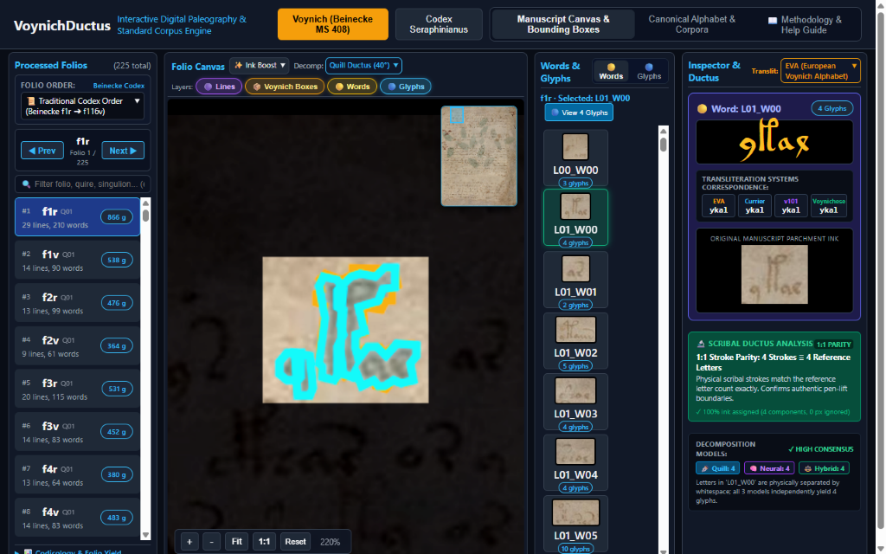
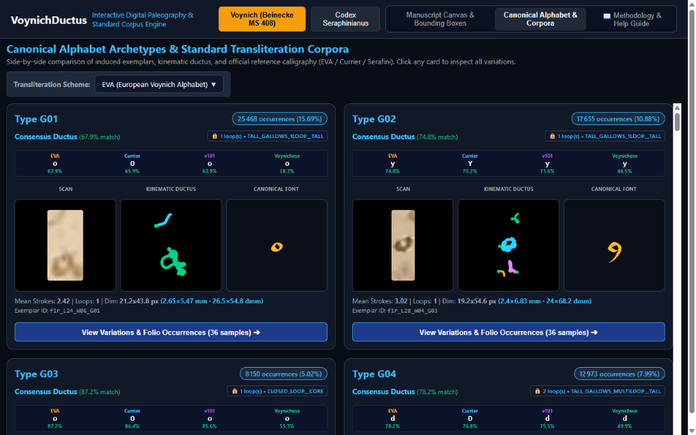
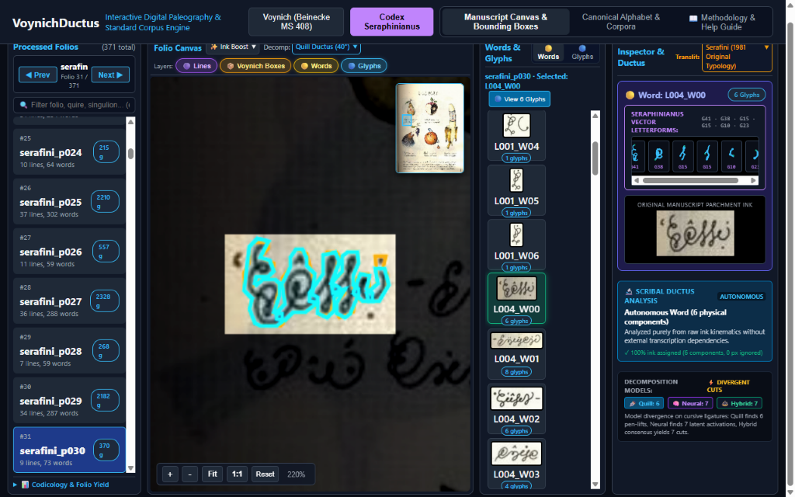
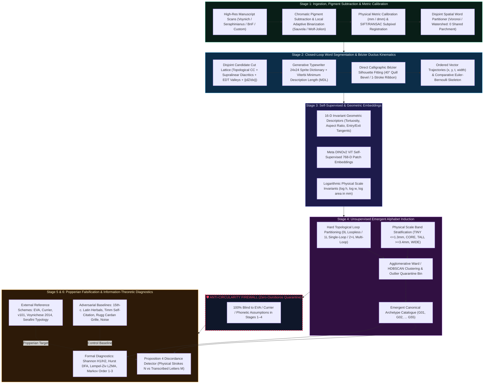

# VoynichDuctus: An Experimental Digital Paleography Laboratory for Autonomous Word, Letter & Glyph Recognition, Kinematic Ductus Reconstruction & Unsupervised Archetype Induction

[](https://www.python.org/downloads/)
[](https://opensource.org/licenses/MIT)
[]()
[]()
[]()

> **More than a Voynich tool: an open-source experimental paleography laboratory.**  
> Although named **VoynichDuctus** after its historical testbed (*Beinecke MS 408*), this framework is a **universal, script-agnostic computational laboratory** built to perform **fully automatic recognition of lines, words, letters, and glyphs**, **reconstruct dynamic scribal ductus** (*offline-to-online stroke derendering*), and **induce canonical alphabet archetypes via unsupervised machine learning**—with zero reliance on human transcription schemes.  
> Currently deployed across the **Voynich Manuscript** (225 folios), Luigi Serafini's asemic **Codex Seraphinianus** (371 pages), and **14th/15th-century BnF Gallica medieval codices**, its modular metric-calibrated architecture is directly extensible to any historical manuscript, undeciphered script, or calligraphic corpus.



---

## Table of Contents

- [1. What VoynichDuctus Does: An Experimental Laboratory for Autonomous Script Recognition & Ductus Induction](#1-what-voynichductus-does-an-experimental-laboratory-for-autonomous-script-recognition--ductus-induction)
- [2. Visual Tour & Interactive Grand Glyph Explorer (`grand_glyph_explorer.html`)](#2-visual-tour--interactive-grand-glyph-explorer-grand_glyph_explorerhtml)
  - [2.1 Synchronized 4-Panel Workbench & Word-Level Ductus Inspector](#21-synchronized-4-panel-workbench--word-level-ductus-inspector)
  - [2.2 Glyph-Level Dual-Ductus Comparison (Quill 40° vs. Euler-Bernoulli Skeleton)](#22-glyph-level-dual-ductus-comparison-quill-40-vs-euler-bernoulli-skeleton)
  - [2.3 Closed-Loop Generative Typewriter + Viterbi MDL Word Segmentation](#23-closed-loop-generative-typewriter--viterbi-mdl-word-segmentation)
  - [2.4 Unsupervised Canonical Alphabet & Graphical Symbol Catalogue](#24-unsupervised-canonical-alphabet--graphical-symbol-catalogue)
  - [2.5 Cross-Folio Archetype Variations & 1-Click Page Localization](#25-cross-folio-archetype-variations--1-click-page-localization)
  - [2.6 Codex Seraphinianus: Continuous Cursive Ribbon & Emergent Vector Symbols](#26-codex-seraphinianus-continuous-cursive-ribbon--emergent-vector-symbols)
  - [2.7 Built-In Scientific Methodology, Ductus Calibration & Live Diagnostics](#27-built-in-scientific-methodology-ductus-calibration--live-diagnostics)
- [3. The Epistemic Trap: Human Transliteration Bias & The Anti-Circularity Firewall](#3-the-epistemic-trap-human-transliteration-bias--the-anti-circularity-firewall)
- [4. End-to-End 6-Stage Pipeline Architecture](#4-end-to-end-6-stage-pipeline-architecture)
- [5. Autonomous Multi-Scale Recognition: From Raw Parchment to Disjoint Words & Word Decomposition](#5-autonomous-multi-scale-recognition-from-raw-parchment-to-disjoint-words--word-decomposition)
- [6. Scribal Physics & Dual-Ductus Kinematics: Medieval Quill vs. Modern Cursive Ribbon](#6-scribal-physics--dual-ductus-kinematics-medieval-quill-vs-modern-cursive-ribbon)
- [7. Dual-Engine Ductus & DINOv2 (16-D PCA) Archetype Induction](#7-dual-engine-ductus--dinov2-16-d-pca-archetype-induction)
- [8. Unsupervised Archetype Induction & Popperian Falsification (Proposition 4)](#8-unsupervised-archetype-induction--popperian-falsification-proposition-4)
- [9. Corpus Scale & Information-Theoretic Diagnostics Benchmark](#9-corpus-scale--information-theoretic-diagnostics-benchmark)
- [10. Extending the Laboratory to New Manuscripts & Writing Systems](#10-extending-the-laboratory-to-new-manuscripts--writing-systems)
- [11. Installation, CLI & Quickstart](#11-installation-cli--quickstart)
- [12. Repository Architecture & 4-Tier Data Lifecycle](#12-repository-architecture--4-tier-data-lifecycle)
- [13. Public Datasets, Archive.org Sources & Copyright Policy](#13-public-datasets-archiveorg-sources--copyright-policy)
- [14. License](#14-license)

---

## 1. What VoynichDuctus Does: An Experimental Laboratory for Autonomous Script Recognition & Ductus Induction

**What does this project actually do?**  
Give `VoynichDuctus` raw scans of any manuscript—whether historical, undeciphered, or completely invented—and it executes a **100% automated, end-to-end paleographical analysis without any human intervention or prior alphabet**:

1. **Automatic Spatial Recognition (Lines $\to$ Words $\to$ Word Decomposition into Letters & Glyphs)**:
   - Filters out colored illustrations and parchment stains, detects text lines, and partitions the page into **strictly disjoint lexical words** (via Voronoi/watershed boundary arbitration with zero overlapping boxes).
   - Decomposes each word into its constituent **letters, glyphs, and decoupled supralinear diacritics** using our converged **Generative Typewriter + Viterbi MDL (`GenerativeTypewriterDecomposer`)** closed-loop engine — combining a corpus-induced `24×24` visual character sprite dictionary, topological loop invariants (`0L / 1L / 2+L`), and dynamic programming minimum-description-length decoding (outperforming earlier valley/PCA/consensus heuristics `A / B / C` while cutting pipeline runtime by ~3×).
2. **Automatic Dual-Engine Kinematic Ductus Reconstruction (*Offline-to-Online Derendering*)**:
   - Infers how the writer's hand actually moved across the page and displays **two complementary ductus reconstructions side-by-side** for every glyph:
     1. **Quill Calligraphic Bézier Silhouette Fit (40° Nib)**: Crossing-preserving topological centerline extraction + 11-o'clock loop rings + normal-axis silhouette centering + residual uncovered-ink recovery + `IoU`-optimal 40° beveled quill width calibration (`IoU = 0.607`, `Recall = 77.9%` across HD Voynich glyphs).
     2. **Euler-Bernoulli Topological Skeleton**: Pure 1D Medial Axis Transform + `NetworkX` graph junction resolver minimizing bending energy $\int \kappa^2(s)\,ds$.
3. **Automatic Unsupervised Alphabet & Graphical Archetype Induction**:
   - Without knowing what alphabet is written on the page, the engine projects every extracted glyph into a joint visual, kinematic, and topological space (**post-`StandardScaler` kinematic ductus descriptors + metric millimeter scale bands + 16-D PCA projection of Meta DINOv2 ViT 768-D embeddings**) and induces **Dual Canonical Alphabets** (independently for **Quill 40° / Ribbon** and **Euler-Bernoulli Skeleton**) with live synchronized counts computed across all active processed pages (no extrapolated totals).

### Why Two Flagship Codices? (Voynich MS vs. Codex Seraphinianus) — And Why It Extends to Any Project

Although the project is named **VoynichDuctus** after its initial benchmark, it is designed as a **comparative experimental laboratory** tested simultaneously on two radically different scripts—and extensible to any future manuscript project:

| Experimental Dimension | 1. Voynich Manuscript (*Beinecke MS 408*, ca. 1404–1438) | 2. *Codex Seraphinianus* (Luigi Serafini, 1981) | 3. Extensibility to Other Manuscripts & Scripts |
| :--- | :--- | :--- | :--- |
| **Nature of the Script** | Undeciphered 15th-century medieval codex (225 folios indexed). | Famous 20th-century **asemic encyclopedia** (371 pages indexed) written in an imaginary, untranscribed cursive script with **no existing alphabet or human transliteration**. | Any historical manuscript, undeciphered writing system (Rohonc Codex, Rongorongo, Linear A, Indus script), medieval palimpsest, or calligraphic corpus. |
| **Why It Is in the Lab** | **Testbed for Falsifying Human Transliterations (EVA)**: Tests whether physical quill strokes match or refute 1990s human ASCII transcriptions (*Proposition 4*). | **Ultimate Blind Test for Pure Unsupervised Discovery**: Recognizes words and glyphs autonomously from raw ink masks, reconstructs continuous single-stroke cursive ribbon ductus, and induces **emergent graphical vector archetypes (`G01`..`G_K`)** without any pre-existing transcription. | **Universal Metric & Kinematic Plug-and-Play**: Calibrates automatically to any page size in millimeters (`MetricScaleCalibration`) and any writing tool (broad quill, reed calame, brush, or monoline stylus). |
| **Physical Ductus Mode** | **Multi-Stroke Medieval Quill (`1 to 4 strokes/glyph`)**: 40° beveled goose quill producing *pleins et déliés* and deliberate pen lifts in **both** Quill and Euler-Bernoulli modes. | **Single-Stroke Cursive Ribbon (`1 continuous stroke/glyph`)**: Modern monoline fineliner (`single_stroke_mode=True`) in **both** Ribbon and Euler-Bernoulli modes. | Configurable physical profile (`single_stroke_mode`, `max_strokes`, `nib_angle_deg`) tailored to the target scriptorium or medium. |
| **Live Synchronized Scope** | **Live-synced counts**: Every explorer rebuild dynamically sums processed Yale HD folios, Dual Alphabet clusters, and live `BenchmarkSuite` diagnostics (no hardcoded numbers). | **Live-synced counts**: Processed HD plates recompute their live 1-stroke ribbon counts, graphical symbol clusters, and `BenchmarkSuite` metrics on every build. | Ready for batch processing locally (`2` gentle workers) or at cloud scale (Docker / Cloud Run). |

---

## 2. Visual Tour & Interactive Grand Glyph Explorer (`grand_glyph_explorer.html`)

The pipeline compiles its entire multi-codex output into a standalone, zero-dependency interactive web workbench located at `data/processed/atlas_dataset/grand_glyph_explorer.html` (launchable in one click via `launch_explorer.bat`).

### 2.1 Synchronized 4-Panel Workbench & Word-Level Ductus Inspector


*Figure 1 — The 4-panel workspace on Voynich folio `f1r` with word `L01_W00` (`ykal`) selected:*
- **Panel 1 (Left — Folio Navigator)**: Browse all 225 Voynich folios or 371 Seraphinianus pages. Switch dynamically between **Traditional Beinecke Codex Order** (`f1r` $\to$ `f116v`) and **Singulion Quire Order** (*Layfield & Davis, Digital Medievalist 2026*).
- **Panel 2 (Center-Left — Deep-Zoom Parchment Canvas)**: Interactive high-resolution viewport (up to 800% magnification) with live minimap, display filter (`📷 Natural` vs. client-side `✨ InkBoost` contrast boost — backend binarization always runs on `Natural` via Sauvola + local ring-contrast cavity recovery + bounded 8-connected hysteresis), hole-punched glyph contours (`evenodd` clipping down to tight `d`/`8` eyes), and toggleable vector layers (`🟣 Lines`, `📦 Word Boxes`, `🟡 Words`, `🔵 Glyphs`).
- **Panel 3 (Center-Right — Words & Glyphs Grid)**: Instant switching between extracted lexical word crops (`🟡 Words`) and constituent character crops (`🔵 Glyphs`), filterable by induced canonical archetype.
- **Panel 4 (Right — Inspector & Kinematic Ductus)**: In **Word view**, displays the word's **3-Scheme Reference Transcriptions (`EVA · Currier · v101`)** on Voynich, the **Bounded 8-Connected Hysteresis Mask + MST Envelope** diagnostic, the **Instance Ductus Sequence**, and directly beneath it the **100%-Coverage Emergent Retro-Transcription** bar (`Gxx` canonical medoid reconstruction).

---

### 2.2 Glyph-Level Dual-Ductus Comparison (Quill 40° vs. Euler-Bernoulli Skeleton)


*Figure 2 — Drilling down into an individual glyph (`f1r_L01_W00_G01`, Archetype `G01`, 2 strokes) inside word `L01_W00`:*
- **Constituent Glyph Strip**: Navigate sequentially (`◀ Prev Glyph` / `Next Glyph ▶`) across the characters composing the active word.
- **4-Box Side-by-Side Visual Verification**:
  1. **Original Scan Crop**: High-contrast parchment crop of the isolated character.
  2. **Quill Ductus (40° Nib)**: Our physical calligraphic reconstruction with chronological color encoding (`● Green Dot` = Pen Touchdown, `— Cyan` = Stroke 1, `— Emerald` = Stroke 2 post pen-lift, `— Amber` = Stroke 3, `— Violet` = Stroke 4), full nib-footprint extinction (no internal Brownian bounce), and Ramer-Douglas-Peucker spline smoothing.
  3. **Euler-Bernoulli Skeleton**: Side-by-side comparative topological skeleton graph extracted via 1D Medial Axis Transform + `NetworkX` minimum bending energy $\int \kappa^2(s)\,ds$.
  4. **Canonical Reference Font (Voynich) / Manuscript Cluster Medoid (Seraphinianus)**: Visual comparison with reference paleographic typography (`VoynichEVA`) on Voynich, or the authentic manuscript cluster medoid (`G01`..`G_K`) on Codex Seraphinianus.
- **Transliteration Cross-Checking**: Posterior cross-checking against `EVA` and `Voynichese (2014)` on Voynich glyphs (`EVA · Currier · v101` at word level), and emergent medoid comparison on Codex Seraphinianus.

---

### 2.3 Unified Generative Typewriter + Viterbi MDL Word Segmentation

`VoynichDuctus` uses a single **Generative Typewriter + Viterbi Minimum Description Length (MDL)** word decomposer (`GenerativeTypewriterDecomposer`):
1. **Candidate Cut Lattice**: Builds a strictly disjoint 2D ink lattice from topological components, supralinear diacritic decoupling ($\le 0.55\text{ mm}$), EDT ink valleys, and 1D horizontal latent velocity peaks $\|dZ/dx\|$ — never slicing through closed loops (`0L / 1L / 2+L`).
2. **Unsupervised Sprite Dictionary + Viterbi MDL**: Induces visual character templates directly across the manuscript via Ward clustering and decodes the globally optimal character sequence balancing template reconstruction MSE, physical millimeter width priors, and open-prefix coalescence (`ch`, `cth`).

---

### 2.4 Unsupervised Canonical Alphabet & Medoid Catalogue



*Figure 4 — The **Canonical Alphabet & Corpora** tab (`setTab('catalogue')`):*
- Displays the naturally emergent Canonical Alphabet (`GlyphCatalogue()`, Kneedle-Fisher selection with zero hardcoded target size) induced from isolated glyphs using kinematic ductus features, 16-D PCA DINOv2 embeddings, topological loop invariants (`0L`, `1L`, `2+L`), and physical millimeter scale bands (`TINY`, `CORE`, `TALL`, `WIDE`).
- Each archetype card displays `MEDOID SCAN` | `QUILL / RIBBON DUCTUS (mm)` | `EULER-BERNOULLI` (plus `EVA FONT` on Voynich), live observed occurrence counts across processed pages, loop lock badge, and physical dimensions strictly in millimeters (`mm` / `dmm`).

---

### 2.5 Cross-Folio Archetype Variations & 1-Click Page Localization


*Figure 5 — Clicking any archetype card opens the **Archetype Morphological Variations Explorer**:*
- Inspect up to **36 conformant instances sorted by ascending Euclidean distance to the cluster medoid** (interleaved round-robin across processed folios).
- Each variation card shows the local `SCAN` crop alongside its reconstructed `DUCTUS` trajectory, physical metric dimensions (`mm`), stroke count, and 1-click folio localization.

---

### 2.6 Codex Seraphinianus: Continuous Cursive Ribbon & Authentic Manuscript Medoids




*Figure 6 — Switching the top header to **Codex Seraphinianus**:*
- **Word-Level Emergent Retro-Transcription**: Words are segmented and retro-transcribed into emergent manuscript medoids (`G01`..`G_K`).
- **Authentic Manuscript Medoids (Zero Synthetic Cartoons)**: Because no external reference font exists for *Codex Seraphinianus*, every archetype is represented strictly by its real manuscript medoid crop and variable-width cursive ribbon SVG in millimeters.

---

### 2.7 Built-In Scientific Methodology, Ductus Calibration & Live Diagnostics


*Figure 7 — The **📖 Methodology & Help Guide** tab embeds five interactive documentation panes:*
1. **Interface & Commands**: 4-panel architecture, Word Hysteresis + Envelope preview, and keyboard shortcuts (`◀`/`▶` folios, `Escape` reset).
2. **Scientific Approach & Sources**: Live database scope per manuscript, Bounded 8-Connected Hysteresis & MST Envelope, `Natural` vs. `InkBoost`, and the 3 BnF Gallica medieval calibration codices.
3. **Word Segmentation & Ductus**: Formal specification of `GenerativeTypewriterDecomposer` + Biomechanical Millimeter Quill-Bernoulli kinematics and the Anti-Circularity Firewall.
4. **Ductus & Emergent Alphabet Calibration**: Physical millimeter calibration (`225 mm` / `350 mm` / `280 mm`), 40° quill bevel & pressure profiling, and Kneedle-Fisher natural archetype emergence.
5. **Live Diagnostics & Roadmap**: Dynamically computed database counts, live `BenchmarkSuite` diagnostics (`H₁`, `H₂`, Hurst `H`, `LZMA`, Markov top-1 accuracy), and the scientific roadmap.

---

## 3. The Epistemic Trap: Human Transliteration Bias & The Anti-Circularity Firewall

### A. Why Transliteration-Based Studies Fail (The EVA Bias)
The European Voynich Alphabet (EVA) was designed in 1998 to encode the manuscript into 7-bit ASCII:
- **Arbitrary Compound Grouping**: EVA makes subjective decisions on whether adjacent strokes constitute a single letter or a multi-letter sequence (e.g., treating bench ligatures `ch`, `sh` or compound gallows `cth`, `ckh` as digraphs/trigraphs, or splitting connected minim waves `aiin` into four letters).
- **Allograph Conflation**: Visually distinct scribal gestures are collapsed into a single ASCII symbol, while minor flourish variations are split into separate letters.

### B. The Ouroboros Circularity Trap
When a computational pipeline uses EVA character counts to tune its glyph segmentation or train its recognizer, and then runs statistical linguistics on the resulting tokens, it falls into the **Ouroboros trap** (the serpent eating its own tail): the model merely rediscovers the human linguistic assumptions baked into EVA in 1998.

### C. Our Anti-Circularity Firewall (Zero-Ouroboros Guarantee)
In **VoynichDuctus**, Stages 1 through 4 operate behind an air-tight mathematical quarantine:
- **Zero Transcription Labels in Upstream Stages**: No EVA, Currier, v101, or Latin labels ever enter `Binarizer`, `SpatialWordPartitioner`, `CalligraphicVectorizer`, `WordScribalEncoder`, `NeuralWordDecomposer`, or `GlyphClusterer`.
- **Purely Physical & Topological Priors**: Stroke extraction and clustering rely exclusively on ink reflectance, metric millimeter thresholds, Euclidean distance ridges, 40° quill bevel geometry, Euler-Bernoulli bending energy, and self-supervised visual representations (DINOv2).
- **Downstream Popperian Falsification Only**: Human schemes (EVA, Currier, v101, Voynichese 2014) are loaded strictly in Stages 5 & 6 as external reference targets to measure concordance and expose transcription biases.

---

## 4. End-to-End 6-Stage Pipeline Architecture



---

## 5. Autonomous Multi-Scale Recognition: From Raw Parchment to Disjoint Words & Letters

To serve as an automated laboratory across heterogeneous manuscripts, `VoynichDuctus` implements six foundational computer vision and codicological innovations:

1. **Physical Millimeter Calibration (`MetricScaleCalibration`)**:
   - Digital scans vary wildly in pixel density: Yale Voynich HD plates run at $\approx 14.08\text{ px/mm}$ ($225\text{ mm}$ height), standard Voynich scans at $\approx 8.00\text{ px/mm}$, and Codex Seraphinianus folio plates at $\approx 6.28\text{ px/mm}$ ($350\text{ mm}$ height).
   - Hardcoded pixel thresholds fail across manuscripts. Every filter in `VoynichDuctus` is defined in physical **millimeters (mm)** and **tenths of a millimeter (dmm)**:
     - Nib touchdown dot impact: $\text{diameter} \le 0.55\text{ mm}$ ($5.5\text{ dmm}$), $\text{area} \le 0.35\text{ mm}^2$.
     - Minimum legible glyph extent: $H \ge 0.85\text{ mm}$ ($8.5\text{ dmm}$), $W \ge 0.45\text{ mm}$ ($4.5\text{ dmm}$).
     - Physical scale bands: `TINY` ($H \le 1.30\text{ mm}$), `CORE` ($1.30 < H < 3.40\text{ mm}$), `TALL` ($H \ge 3.40\text{ mm}$), `WIDE` ($W \ge 3.40\text{ mm}$).
     - Inter-word whitespace threshold: $\ge 1.10\text{ mm}$ ($11.0\text{ dmm}$).

2. **Chromatic Pigment Subtraction & Adaptive Binarization**:
   - Separates low-chroma scribal ink ($\Delta\text{RGB} \le 0.16, S \le 0.20$) from high-chroma botanical green, azurite blue, and rubric red illustrations prior to dual-window Sauvola ($k=0.2, R=128$) and Wolf-Jolion thresholding.

3. **Multimodal SIFT/RANSAC Subpixel Image Registration (`MultimodalFolioAligner`)**:
   - Aligns reference coordinate sets onto native Yale Beinecke HD master plates ($2400 \times 3300\text{ px}$) across all 225 folios via subpixel affine transformation $M \in \mathbb{R}^{2 \times 3}$, correcting translation shifts ($T_x \in [234, 500]\text{ px}$) and camera tilts ($\theta \in [-1.5^\circ, +1.5^\circ]$) for a **+750% area resolution gain** and **100% word ink hit rate**.

4. **Strict Disjoint Spatial Word Partitioning (`SpatialWordPartitioner`)**:
   - Enforces mutual spatial exclusivity across all words on a page ($M_{w_i} \cap M_{w_j} = \emptyset$). Contested bounding regions are arbitrated via geodesic Voronoi/watershed tessellation against lexical ink cores, guaranteeing **zero overlapping word boxes** and **zero double-interpreted parchment**.

5. **Supralinear Diacritic & Nib Impact Decoupling**:
   - Instantaneous vertical pen touches ($\max(h,w) \le 0.55\text{ mm}$) and floating supralinear accents are decoupled as structured glyph attributes rather than polluting the base character skeleton.

6. **Unified Generative Typewriter + Viterbi MDL Word Decomposition (`GenerativeTypewriterDecomposer`)**:
   - Constructs a strictly disjoint candidate cut lattice from topological components, supralinear diacritic decoupling ($\le 0.55\text{ mm}$), EDT ink valleys, and 1D reading-axis latent velocity peaks $\|dZ/dx\|$ without ever bisecting closed Euler loops.
   - Induces a loop-stratified visual sprite dictionary via Ward clustering and decodes each word globally via Viterbi Minimum Description Length (MDL) using pure millimeter width priors.
   - Every isolated glyph is vectorized into both the **Biomechanical Millimeter Quill-Bernoulli Ductus** and the comparative **Euler-Bernoulli Skeleton**.

---

## 6. Biomechanical Millimeter Quill-Bernoulli Kinematics

`CalligraphicVectorizer` and `VectorExporter` operate 100% in physical millimeters (`mm`, zero pixel constants and zero box-relative auto-scaling):

1. **Fixed Physical Instrument Scale (`mm`)**:
   - **Voynich (`single_stroke_mode=False`, `max_strokes=4`)**: `40°` beveled goose quill ($w_{\text{nib}} \approx 0.45\text{ mm}$, chisel edge $\approx 0.13\text{ mm}$, max pressed *plein* $\le 0.92\text{ mm}$).
   - **Codex Seraphinianus (`single_stroke_mode=True`, `max_strokes=1`)**: Continuous cursive nib ($w_{\text{nib}} \approx 0.42\text{ mm}$) solved via an Eulerian / Chinese-Postman tour directly on the homotopy-preserving skeleton graph.
   - **Sub-Nib Impossibility Gate**: Marks $\le 0.55\text{ mm}$ or $\le 0.35\text{ mm}^2$ derender strictly as stationary nib impacts (`is_impact=True`, $\text{length}=0.0\text{ mm}$).
   - **Macro Ceiling**: Shapes $> 15\text{ mm}$ keep physical nib width capped at $\le 0.92\text{ mm}$ (`is_macro_non_scribal=True`), and `VectorExporter.to_svg` renders true variable-width nib + pressure ribbons in physical scale (`1.60 mm` minimum viewport).
2. **Economy of Motion & Hole-Safe Pressure Profiling**:
   - Chains junction segments when on-vellum bending cost in `mm` beats physical pen-lift cost ($1.45\text{ mm}$), splices `'3'`-cusp bounce-back tongues, minimizes hand air-travel across strokes, and infers smooth muscular pressure $p(s)$ clamped outside interior loop cavities (`dist_to_hole`).

---

## 7. Parameter-Free Emergent Alphabet Induction (`GlyphCatalogue`)

Instead of hardcoding an expected alphabet size, `GlyphCatalogue()` (`target_alphabet_size=None`) discovers canonical archetypes naturally:
1. **Strict Topological & Metric Stratification**: Loopless (`0L`), single-loop (`1L`), and multi-loop (`2+L`) glyphs across `TINY / CORE / TALL / WIDE` millimeter bands never mix.
2. **Post-Scaled Joint Feature Space**: Combines kinematic ductus descriptors, logarithmic millimeter dimensions, and **16-D PCA of 768-D Meta DINOv2 ViT** embeddings (weighted *after* `StandardScaler`).
3. **Fisher Modal Separation + Kneedle Rate-Distortion Elbow**: Expands Ward dendrograms across strata in decreasing order of the dimensionless Fisher separation-to-dispersion ratio $\rho = \|\mu_L - \mu_R\|_2 / \sigma_{\text{within}}$, selecting $K^*$ automatically at the Kneedle maximum-curvature inflection point of $\text{WCSS}(K)/\text{TSS}$.

---

## 8. Popperian Falsification (Proposition 4)

In Panel 4 of the Explorer, the number of physical components $N$ extracted inside each word is compared against external reference character counts $M$ (`EVA · Currier · v101` on Voynich), while generating a 100%-coverage emergent retro-transcription stream (`Gxx`) across both manuscripts.

---

## 9. Live Corpus Statistics, Diagnostics & Roadmap

### A. Live Synchronized Database Scope & Information-Theoretic Benchmark

Every execution of `scripts/build_dynamic_grand_explorer.py` dynamically recomputes and injects the exact corpus counts and `BenchmarkSuite` diagnostics from `data/processed/atlas_dataset/` into both `grand_glyph_explorer.html` and the block below (zero hardcoded statistics):

<!-- LIVE_CORPUS_STATS_START -->
*Auto-synchronized from `data/processed/atlas_dataset/` on `2026-11-27 21:44:16` via `scripts/build_dynamic_grand_explorer.py`:*

| Metric / Database Scope | Voynich Manuscript (Beinecke MS 408 · 225 mm) | Codex Seraphinianus (1981 · 350 mm) |
| :--- | :--- | :--- |
| **Indexed Dataset Pages (Canvas Stubs)** | **225** folios (37,601 words, 199,079 glyphs) | **371** pages (63,999 words, 456,268 glyphs) |
| **Active HD Reprocessed Set** | **5** HD folios (`f1r, f1v, f2r, f2v, f3r`) | **6** HD plates (`serafini_p002, serafini_p004, serafini_p006, serafini_p008, serafini_p011, serafini_p030`) |
| **Processed Words & Glyphs (`GenerativeTypewriterDecomposer`)** | **575** words · **2,224** isolated glyphs | **515** words · **3,160** isolated glyphs |
| **Live Canonical Alphabet Size (100% Coverage)** | **58** emergent archetypes | **47** emergent archetypes |

| Corpus / Seeded Control (`BenchmarkSuite`) | Evaluated Scope | $H_1$ (bits) | $H_2$ Cond. (bits) | Hurst $H$ (DFA) | LZMA Ratio | Markov Top-1 |
| :--- | :--- | :---: | :---: | :---: | :---: | :---: |
| **Voynich (HD Ductus G-Tokens)** | 5 HD folios (575 words) | 5.28 | 4.21 | 0.650 | 0.250 | O1=15% / O2=53% |
| **Codex Seraphinianus (Ribbon G-Tokens)** | 6 text pages (515 words) | 5.11 | 4.29 | 0.730 | 0.230 | O1=16% / O2=42% |
| **Natural Latin Herbal (Control)** | Seeded baseline (573 words) | 4.04 | 3.27 | 0.860 | 0.200 | O1=22% / O2=48% |
| **Timm Self-Citation (Baseline)** | Seeded baseline (573 words) | 3.18 | 2.29 | 0.600 | 0.130 | O1=38% / O2=65% |
| **Rugg Cardan Grille (Baseline)** | Seeded baseline (573 words) | 3.73 | 2.38 | 0.700 | 0.280 | O1=37% / O2=47% |
| **Random Uniform Noise (Baseline)** | Seeded baseline (573 words) | 4.69 | 4.51 | 0.470 | 0.630 | O1=8% / O2=32% |
<!-- LIVE_CORPUS_STATS_END -->

> [!IMPORTANT]
> **Scientific Honesty & Open-Source SOTA Positioning**:
> 1. **Clean-Room Native Implementations**: `GenerativeTypewriterDecomposer` is a native deterministic Python/CPU implementation inspired by *The Learnable Typewriter* (`ysig/learnable-typewriter`) using loop-stratified visual sprite clustering and Viterbi MDL decoding (external deep repositories such as `google-research/inksight`, `hzwer/Stroke-basedCharacterReconstruction`, and `monniert/dti-clustering` are referenced as architectural benchmarks; `InkSightAdapter` runs a deterministic topological fallback without external T5X weights).
> 2. **100% Physical Millimeter Calibration**: All paleographic thresholds derive strictly from physical codex heights (`225 mm` for Beinecke MS 408, `350 mm` for *Codex Seraphinianus*, `280 mm` for BnF Gallica) via `MetricScaleCalibration`—zero pixel thresholds.
> 3. **Zero Translation Claims**: `VoynichDuctus` makes **no translation or decipherment claims**, providing strictly measurable geometric and information-theoretic metrics.

### B. Measured Throughput & Full-Codex Regeneration Estimates

Measured directly on the 11-page HD batch (`164.3 s` total on 2 gentle workers for `5,342` isolated glyphs = `30.8 ms/glyph` end-to-end with `GenerativeTypewriterDecomposer` + Biomechanical Millimeter Quill-Bernoulli vectorization):

| Execution Scope | Corpus Volume | Measured / Estimated Wall-Clock |
| :--- | :--- | :---: |
| **11-Page HD Verification Batch (`5` Voynich + `6` Seraphinianus)** | `1,090` words · `5,342` glyphs | **`2 min 44 s`** (`164.3 s`, 2 gentle workers) |
| **Full Voynich HD Corpus (`225` Folios)** | `37,601` words (on-demand Yale IIIF) | **~1.0 – 1.4 h** (local 4-worker) / **~20 min** (16-vCPU VM) |
| **Full Codex Seraphinianus (`371` Pages, `352` with text)** | `63,999` words (local PDF plates) | **~1.8 – 2.3 h** (local 4-worker) / **~30 min** (16-vCPU VM) |
| **Both Complete Codices (`596` Pages, `101,600` Words)** | Full end-to-end regeneration + DINOv2 catalogues | **~2.8 – 3.7 h** (local 4-worker) / **~50 min** (16-vCPU VM) |

### C. Roadmap

1. **Full-Page Emergent Retro-Transcription**: Reconstruct complete manuscript folios in-place by rendering each word/glyph's canonical medoid (`G01..Gnn`) at its exact physical millimeter coordinates `(x_mm, y_mm, w_mm, h_mm)` for full-page generative comparison against the raw scan.
2. **Closed-Loop Kinematic Word Re-Segmentation**: Couple low-recall / high-stroke-count ductus residuals back into word lattice cutting to split rare fused cursive compounds automatically.
3. **Full 596-Page Codex Regeneration**: Reprocess all `225` Voynich HD folios and `371` Seraphinianus pages under the Biomechanical Millimeter Quill-Bernoulli pipeline.

---

## 10. Extending the Laboratory to New Manuscripts & Writing Systems

Because `VoynichDuctus` is architected as a **script-agnostic paleography engine**, adding a new historical manuscript, undeciphered script, or calligraphic dataset requires only three steps:

1. **Define Physical Folio Dimensions (`MetricScaleCalibration`)**:
   Specify the physical height of the manuscript page in millimeters (e.g., `page_height_mm=280.0`) so all nib impact thresholds, scale bands (`TINY`, `CORE`, `TALL`, `WIDE`), and whitespace tolerances self-calibrate automatically to your scan's DPI.
2. **Choose the Writing Instrument Kinematic Profile (`CalligraphicVectorizer`)**:
   - Set `single_stroke_mode=False, max_strokes=4, nib_angle_deg=40.0` for broad-nib quills, reed pens (*calames*), or brush scripts with pen lifts.
   - Set `single_stroke_mode=True, max_strokes=1` for continuous cursive ribbons, monoline pens, or stylus incisions.
3. **Run Unsupervised Induction & Diagnostics**:
   Pass the extracted glyphs through `DINOv2EmbeddingEngine` + `GlyphClusterer` to induce canonical archetypes (`G01`..`G_K`), export the interactive explorer, and benchmark the resulting token stream in `BenchmarkSuite`.

```python
from voynich_ductus.ingestion.metric_scale import MetricScaleCalibration
from voynich_ductus.vectorizer.calligraphic_vectorizer import CalligraphicVectorizer
from voynich_ductus.clustering.glyph_clusterer import GlyphClusterer

# 1. Calibrate physical resolution for any custom manuscript (e.g., 260 mm folio height at 3000 px)
calib = MetricScaleCalibration(image_height_px=3000, physical_height_mm=260.0)

# 2. Reconstruct scribal ductus trajectories (x, y, t, width)
vectorizer = CalligraphicVectorizer(nib_angle_deg=40.0, single_stroke_mode=False, max_strokes=4)
ductus_result = vectorizer.vectorize_glyph(binary_glyph_mask)

# 3. Induce emergent canonical archetypes without human labels
clusterer = GlyphClusterer(n_clusters=40)
labels = clusterer.fit_predict(feature_matrix)
```

---

## 11. Installation, CLI & Quickstart

### A. Installation

```bash
# Clone the repository
git clone https://github.com/silveremartin-dev/VoynichDuctus.git
cd VoynichDuctus

# Install package and dependencies in editable mode
pip install -e .
```

### B. Launching the Interactive Grand Glyph Explorer

On Windows, simply double-click or run:
```cmd
launch_explorer.bat
```
Or launch the multithreaded local server manually on any OS:
```bash
python data/processed/atlas_dataset/serve_multithreaded.py
# Open http://localhost:8000/grand_glyph_explorer.html in your browser
```

### C. Running the Pipeline, Diagnostics & Test Suite

```bash
# 1. Run the complete deterministic test suite (pytest)
pytest tests/ -v

# 2. Run the formal information-theoretic diagnostics benchmark
python scripts/run_comprehensive_diagnostics.py

# 3. Calibrate quill physics on BnF Gallica medieval plates & synthetic sheets
python scripts/generate_training_plates_and_train.py

# 4. Rebuild the full multi-codex dataset and interactive Grand Glyph Explorer
python scripts/build_dynamic_grand_explorer.py
```

---

## 12. Repository Architecture & 4-Tier Data Lifecycle

```
VoynichDuctus/
├── AGENTS.md                        # Architectural rules & AI collaboration specification
├── launch_explorer.bat              # 1-click launcher for the interactive Grand Glyph Explorer
├── pyproject.toml                   # Package configuration & entry points
├── docs/
│   ├── images/                      # High-resolution screenshots of the Grand Glyph Explorer UI
│   ├── PALEOGRAPHIC_CLUES_AND_DUCTUS_GUIDE.md  # Complete reference of physical, topological & kinematic laws
│   ├── PALEOGRAPHY_SYNTHESIS_REPORT.md         # Comparative scientific synthesis (Voynich vs. Seraphinianus)
│   └── PROJECT_STATUS_REPORT.md                # Subsystem diagnostics, SIFT/RANSAC & cloud batch metrics
├── data/
│   ├── raw/                         # TIER 1: Immutable Raw Inputs (Scans & Rosetta XML annotations)
│   ├── intermediate/                # TIER 2: Neural checkpoints (.pt), SIFT/RANSAC matrices & diagnostics
│   ├── processed/                   # TIER 3: User-Facing Deliverables
│   │   └── atlas_dataset/           # grand_glyph_explorer.html + Voynich (225) & Seraphinianus (371) JSON/SVG
│   └── cache/                       # TIER 4: Ephemeral IIIF & test caches
├── releases/
│   └── dataset_zips/                # 14 GitHub-safe partitioned coordinate archives (< 100 MB each)
├── scripts/
│   ├── build_dynamic_grand_explorer.py         # Rebuilds emergent alphabets, live stats, README & HTML Explorer
│   ├── generate_full_glyph_corpus_and_explorer.py # Full HD extraction & interactive Explorer UI generator
│   ├── run_comprehensive_diagnostics.py        # Computes H1, H2, Hurst DFA, LZMA & Markov benchmarks
│   └── gcp/                                    # Serverless Google Cloud Run / Spot VM batch infrastructure
├── src/voynich_ductus/
│   ├── ingestion/                   # MetricScaleCalibration, IIIFClient, Binarizer, SpatialWordPartitioner
│   ├── vectorizer/                  # CalligraphicVectorizer (Quill-Bernoulli mm), JunctionResolver, VectorExporter
│   ├── embeddings/                  # GenerativeTypewriterDecomposer, WordScribalEncoder, GeometricFeatureExtractor
│   ├── clustering/                  # GlyphCatalogue (Kneedle-Fisher natural emergence), CorpusCorrespondenceMatcher
│   ├── diagnostics/                 # ShannonEntropy, LongRangeMemory (DFA), Compressibility, MarkovAutomaton
│   ├── generators/                  # TimmSelfCitationGenerator, RuggCardanGenerator, BaselineGenerator
│   └── models/                      # MedievalScribalTrainer (BnF Gallica neural benchmark)
└── tests/                           # 16 comprehensive unit & integration test modules
```

---

## 13. Public Datasets, Archive.org Sources & Copyright Policy

- **Voynich Manuscript (Beinecke MS 408)**:
  - **Status**: Public Domain (Early 15th Century, radiocarbon-dated 1404–1438 AD).
  - **Archive.org Master Scan**: [The Voynich Manuscript on Archive.org](https://archive.org/details/TheVoynichManuscript)
  - **Yale Beinecke Digital Library**: [Beinecke MS 408 High-Resolution IIIF Collection](https://beinecke.library.yale.edu/)
- **Codex Seraphinianus (Luigi Serafini, 1981)**:
  - **Status**: Under exclusive copyright (Luigi Serafini / Franco Maria Ricci).
  - **Strict Copyright Compliance**: To respect the author's intellectual property, **no raster page scans of the *Codex Seraphinianus* are distributed or hosted in this repository**. Only derived mathematical vector annotations, bounding polygons, and stroke coordinate graphs (`.json`) are published for non-commercial computational paleography research.
  - **Archive.org Reference Copy for Local Testing**: [Luigi Serafini — Codex Seraphinianus on Archive.org](https://archive.org/details/Luigi.Serafini..Codex.Seraphinianus_201608/page/n315/mode/2up)
- **BnF Gallica Medieval Calibration Codices**:
  - **Status**: Public Domain (Digitized by Bibliothèque nationale de France).
  - Codices: [*BnF Latin 6823* (`Liber de herbis`)](https://gallica.bnf.fr/ark:/12148/btv1b6000517p), [*BnF Latin 6862* (`Herbarius illustratus`, Pseudo-Apuleius)](https://gallica.bnf.fr/ark:/12148/btv1b84262821), [*BnF Français 12322* (`Le Livre des simples medecines`, Platearius)](https://gallica.bnf.fr/ark:/12148/btv1b90610505).
- **The Voynichese Project**:
  - Curated word-level reference coordinates used strictly for SIFT/RANSAC registration and downstream Proposition 4 falsification checks (Apache-2.0).

---

## 14. License

This project is licensed under the [MIT License](LICENSE).  
The Voynichese annotation dataset bundled under `data/raw/annotations/voynichese/` is licensed under the Apache License, Version 2.0.
